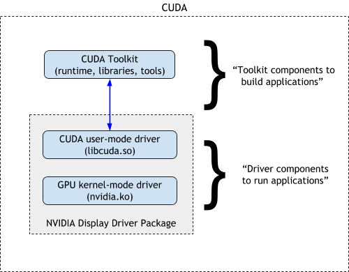

# [16. CUDA Compatibility Developer’s Guide](https://docs.nvidia.com/cuda/cuda-c-best-practices-guide#cuda-compatibility-developer-s-guide)

CUDA Toolkit is released on a monthly release cadence to deliver new features, performance improvements, and critical bug fixes. CUDA compatibility allows users to update the latest CUDA Toolkit software (including the compiler, libraries, and tools) without requiring update to the entire driver stack.

The CUDA software environment consists of three parts:

- CUDA Toolkit (libraries, CUDA runtime and developer tools) - SDK for developers to build CUDA applications.
- CUDA driver - User-mode driver component used to run CUDA applications (e.g. libcuda.so on Linux systems).
- NVIDIA GPU device driver - Kernel-mode driver component for NVIDIA GPUs.

On Linux systems, the CUDA driver and kernel mode components are delivered together in the NVIDIA display driver package. This is shown in Figure 1.

Figure 17 Components of CUDA

The CUDA compiler (nvcc), provides a way to handle CUDA and non-CUDA code (by splitting and steering compilation), along with the CUDA runtime, is part of the CUDA compiler toolchain. The CUDA Runtime API provides developers with high-level C++ interface for simplified management of devices, kernel executions etc., While the CUDA driver API provides ([CUDA Driver API](https://docs.nvidia.com/cuda/cuda-driver-api/index.html)) a low-level programming interface for applications to target NVIDIA hardware.

Built on top of these technologies are CUDA libraries, some of which are included in the CUDA Toolkit, while others such as cuDNN may be released independently of the CUDA Toolkit.
