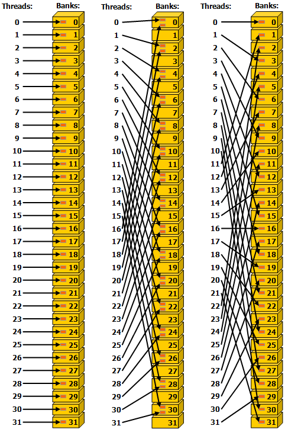
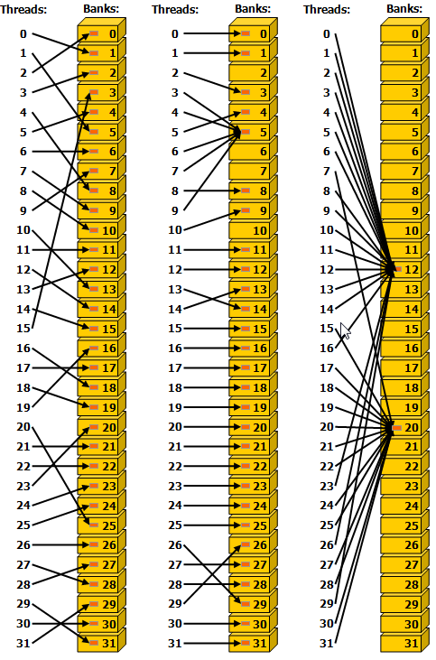

### [2.2.4.2. Shared Memory Access Patterns](https://docs.nvidia.com/cuda/cuda-programming-guide/02-basics#shared-memory-access-patterns)[](https://docs.nvidia.com/cuda/cuda-programming-guide/02-basics/#shared-memory-access-patterns "Permalink to this headline")

Shared memory has 32 banks that are organized such that successive 32-bit words map to successive banks. Each bank has a bandwidth of 32 bits per clock cycle.

When multiple threads in the same warp attempt to access different elements in the same bank, a bank conflict occurs.  In this case, the access to the data in that bank will be serialized until the data in that bank has been obtained by all the threads that have requested it.  This serialization of access results in a performance penalty.

The two exceptions to this scenario happen when multiple threads in the same warp are accessing (either reading or writing) the same shared memory location.  For read accesses, the word is broadcast to the requesting threads.  For write accesses, each shared memory address is written by only one of the threads (which thread performs the write is undefined).

[Figure 13](https://docs.nvidia.com/cuda/cuda-programming-guide/02-basics/#writing-cuda-kernels-shared-memory-5-x-examples-of-strided-shared-memory-accesses) shows some examples of strided access.  The red box inside the bank indicates a unique location in shared memory.



Figure 13 Strided Shared Memory Accesses in 32 bit bank size mode.[](https://docs.nvidia.com/cuda/cuda-programming-guide/02-basics/#writing-cuda-kernels-shared-memory-5-x-examples-of-strided-shared-memory-accesses "Link to this image")

**Left**

  Linear addressing with a stride of one 32-bit word (no bank conflict).

**Middle**

  Linear addressing with a stride of two 32-bit words (two-way bank conflict).

**Right**

  Linear addressing with a stride of three 32-bit words (no bank conflict).

[Figure 14](https://docs.nvidia.com/cuda/cuda-programming-guide/02-basics/#writing-cuda-kernels-shared-memory-5-x-examples-of-irregular-shared-memory-accesses) shows some examples of memory read accesses that involve the broadcast mechanism.  The red box inside the bank indicates a unique location in shared memory.  If multiple arrows point to the same location, the data is broadcast to all threads that requested it.



Figure 14 Irregular Shared Memory Accesses.[](https://docs.nvidia.com/cuda/cuda-programming-guide/02-basics/#writing-cuda-kernels-shared-memory-5-x-examples-of-irregular-shared-memory-accesses "Link to this image")

**Left**

  Conflict-free access via random permutation.

**Middle**

  Conflict-free access since threads 3, 4, 6, 7, and 9 access the same word within bank 5.

**Right**

  Conflict-free broadcast access (threads access the same word within a bank).

> **Note**
>
> Avoiding bank conflicts is an important performance consideration for writing performant CUDA kernels that use shared memory.

#### [2.2.4.2.1. Matrix Transpose Example Using Shared Memory](https://docs.nvidia.com/cuda/cuda-programming-guide/02-basics#matrix-transpose-example-using-shared-memory)[](https://docs.nvidia.com/cuda/cuda-programming-guide/02-basics/#matrix-transpose-example-using-shared-memory "Permalink to this headline")

In the previous example [Matrix Transpose Example Using Global Memory](https://docs.nvidia.com/cuda/cuda-programming-guide/02-basics/#writing-cuda-kernels-matrix-transpose-example-global-memory), a naive implementation of matrix transpose was illustrated that was functionally correct, but not optimized for efficient use of global memory because the write of the `c` matrix was not coalesced properly.  In this example, shared memory will be treated as a user-managed cache to stage loads and stores from global memory, resulting in coalesced global memory access of both reads and writes.

**Example**

```cuda
 1/* definitions of thread block size in X and Y directions */
 2
 3#define THREADS_PER_BLOCK_X 32
 4#define THREADS_PER_BLOCK_Y 32
 5
 6/* macro to index a 1D memory array with 2D indices in row-major order */
 7/* ld is the leading dimension, i.e. the number of columns in the matrix     */
 8
 9#define INDX( row, col, ld ) ( ( (row) * (ld) ) + (col) )
10
11/* CUDA kernel for shared memory matrix transpose */
12
13__global__ void smem_cuda_transpose(int m, float *a, float *c )
14{
15
16    /* declare a statically allocated shared memory array */
17
18    __shared__ float smemArray[THREADS_PER_BLOCK_X][THREADS_PER_BLOCK_Y];
19
20    /* determine my row tile and column tile index */
21
22    const int tileCol = blockDim.x * blockIdx.x;
23    const int tileRow = blockDim.y * blockIdx.y;
24
25    /* read from global memory into shared memory array */
26    smemArray[threadIdx.x][threadIdx.y] = a[INDX( tileRow + threadIdx.y, tileCol + threadIdx.x, m )];
27
28    /* synchronize the threads in the thread block */
29    __syncthreads();
30
31    /* write the result from shared memory to global memory */
32    c[INDX( tileCol + threadIdx.y, tileRow + threadIdx.x, m )] = smemArray[threadIdx.y][threadIdx.x];
33    return;
34
35} /* end smem_cuda_transpose */
```

**Example with array checks**

```cuda
 1/* definitions of thread block size in X and Y directions */
 2
 3#define THREADS_PER_BLOCK_X 32
 4#define THREADS_PER_BLOCK_Y 32
 5
 6/* macro to index a 1D memory array with 2D indices in column-major order */
 7/* ld is the leading dimension, i.e. the number of rows in the matrix     */
 8
 9#define INDX( row, col, ld ) ( ( (col) * (ld) ) + (row) )
10
11/* CUDA kernel for shared memory matrix transpose */
12
13__global__ void smem_cuda_transpose(int m,
14                                    float *a,
15                                    float *c )
16{
17
18    /* declare a statically allocated shared memory array */
19
20    __shared__ float smemArray[THREADS_PER_BLOCK_X][THREADS_PER_BLOCK_Y];
21
22    /* determine my row and column indices for the error checking code */
23
24    const int myRow = blockDim.x * blockIdx.x + threadIdx.x;
25    const int myCol = blockDim.y * blockIdx.y + threadIdx.y;
26
27    /* determine my row tile and column tile index */
28
29    const int tileX = blockDim.x * blockIdx.x;
30    const int tileY = blockDim.y * blockIdx.y;
31
32    if( myRow < m && myCol < m )
33    {
34        /* read from global memory into shared memory array */
35        smemArray[threadIdx.x][threadIdx.y] = a[INDX( tileX + threadIdx.x, tileY + threadIdx.y, m )];
36    } /* end if */
37
38    /* synchronize the threads in the thread block */
39    __syncthreads();
40
41    if( myRow < m && myCol < m )
42    {
43        /* write the result from shared memory to global memory */
44        c[INDX( tileY + threadIdx.x, tileX + threadIdx.y, m )] = smemArray[threadIdx.y][threadIdx.x];
45    } /* end if */
46    return;
47
48} /* end smem_cuda_transpose */
```

The fundamental performance optimization illustrated in this example is to ensure that when accessing global memory, the memory accesses are coalesced properly.  Prior to the execution of the copy, each thread computes its `tileRow` and `tileCol` indices.  These are the indices for the specific tile that will be operated on, and these tile indices are based on which thread block is executing.  Each thread in the same thread block has the same `tileRow` and `tileCol` values, so it can be thought of as the starting position of the tile that this specific thread block will operate on.

The kernel then proceeds with each thread block copying a 32 x 32 tile of the matrix from global memory to shared memory with the following statement.  Since the size of a warp is 32 threads, this copy operation will be executed by 32 warps, with no guaranteed order between the warps.

```c++
smemArray[threadIdx.x][threadIdx.y] = a[INDX( tileRow + threadIdx.y, tileCol + threadIdx.x, m )];
```

Note that because `threadIdx.x` appears in the second argument to `INDX`, consecutive threads are accessing consecutive elements in memory, and the read of `a` is perfectly coalesced.

The next step in the kernel is the call to the `__syncthreads()` function. This ensures that all threads in the thread block have completed their execution of the previous code before proceeding and therefore that the write of `a` into shared memory is completed before the next step.  This is critically important because the next step will involve threads reading from shared memory.  Without the `__syncthreads()` call, the read of `a` into shared memory would not be guaranteed to be completed by all the warps in the thread block before some warps advance further in the code.

At this point in the kernel, for each thread block, the `smemArray` has a 32 x 32 tile of the matrix, arranged in the same order as the original matrix.  To ensure that the elements within the tile are transposed properly, `threadIdx.x` and `threadIdx.y` are swapped when they read `smemArray`.  To ensure that the overall tile is placed in the correct place in `c`, the `tileRow` and `tileCol` indices are also swapped when they write to `c`.  To ensure proper coalescing, `threadIdx.x` is used in the second argument to `INDX`, as shown by the statement below.

```c++
c[INDX( tileCol + threadIdx.y, tileRow + threadIdx.x, m )] = smemArray[threadIdx.y][threadIdx.x];
```

This kernel illustrates two common uses of shared memory.

- Shared memory is used to stage data from global memory to ensure that reads from and writes to global memory are both coalesced properly.
- Shared memory is used to allow threads in the same thread block to share data among themselves.

#### [2.2.4.2.2. Shared Memory Bank Conflicts](https://docs.nvidia.com/cuda/cuda-programming-guide/02-basics#shared-memory-bank-conflicts)[](https://docs.nvidia.com/cuda/cuda-programming-guide/02-basics/#shared-memory-bank-conflicts "Permalink to this headline")

In [Section 2.2.4.2](https://docs.nvidia.com/cuda/cuda-programming-guide/02-basics/#writing-cuda-kernels-shared-memory-access-patterns), the bank structure of shared memory was described.  In the previous matrix transpose example, the proper coalesced memory access to/from global memory was achieved, but no consideration was given to whether shared memory bank conflicts were present.  Consider the following 2d shared memory declaration,

```c++
__shared__ float smemArray[32][32];
```

Since a warp is 32 threads, each thread in the same warp will have a fixed value for `threadIdx.y` and will have `0 <= threadIdx.x < 32`.

The left panel of [Figure 15](https://docs.nvidia.com/cuda/cuda-programming-guide/02-basics/#writing-cuda-kernels-figure-bank-conflicts-shared-mem) illustrates the situation when the threads in a warp access the data in a column of `smemArray`.  Warp 0 is accessing memory locations `smemArray[0][0]` through `smemArray[31][0]`.  In C++ multi-dimensional array ordering, the last index moves the fastest, so consecutive threads in warp 0 are accessing memory locations that are 32 elements apart.  As illustrated in the figure, the colors denote the banks, and this access down the entire column by warp 0 results in a 32-way bank conflict.

The right panel of [Figure 15](https://docs.nvidia.com/cuda/cuda-programming-guide/02-basics/#writing-cuda-kernels-figure-bank-conflicts-shared-mem) illustrates the situation when the threads in a warp access the data across a row of `smemArray`.  Warp 0 is accessing memory locations `smemArray[0][0]` through `smemArray[0][31]`.  In this case, consecutive threads in warp 0 are accessing memory locations that are adjacent.  As illustrated in the figure, the colors denote the banks, and this access across the entire row by warp 0 results in no bank conflicts.  The ideal scenario is for each thread in a warp to access a shared memory location with a different color.


Figure 15 Bank structure in a 32 x 32 shared memory array.[](https://docs.nvidia.com/cuda/cuda-programming-guide/02-basics/#writing-cuda-kernels-figure-bank-conflicts-shared-mem "Link to this image")

The numbers in the boxes indicate the warp index.  The colors indicate which bank is associated with that shared memory location.

Returning to the example from [Section 2.2.4.2.1](https://docs.nvidia.com/cuda/cuda-programming-guide/02-basics/#writing-cuda-kernels-matrix-transpose-example-shared-memory), one can examine the usage of shared memory to determine whether bank conflicts are present.  The first usage of shared memory is when data from global memory is stored to shared memory:

```c++
smemArray[threadIdx.x][threadIdx.y] = a[INDX( tileRow + threadIdx.y, tileCol + threadIdx.x, m )];
```

Because C++ arrays are stored in row-major order, consecutive threads in the same warp, as indicated by consecutive values of `threadIdx.x`, will access `smemArray` with a stride of 32 elements, because `threadIdx.x` is the first index into the array.  This results in a 32-way bank conflict and is illustrated by the left panel of [Figure 15](https://docs.nvidia.com/cuda/cuda-programming-guide/02-basics/#writing-cuda-kernels-figure-bank-conflicts-shared-mem).

The second usage of shared memory is when data from shared memory is written back to global memory:

```c++
c[INDX( tileCol + threadIdx.y, tileRow + threadIdx.x, m )] = smemArray[threadIdx.y][threadIdx.x];
```

In this case, because `threadIdx.x` is the second index into the `smemArray` array, consecutive threads in the same warp will access `smemArray` with a stride of 1 element.  This results in no bank conflicts and is illustrated by the right panel of [Figure 15](https://docs.nvidia.com/cuda/cuda-programming-guide/02-basics/#writing-cuda-kernels-figure-bank-conflicts-shared-mem).

The matrix transpose kernel as illustrated in [Section 2.2.4.2.1](https://docs.nvidia.com/cuda/cuda-programming-guide/02-basics/#writing-cuda-kernels-matrix-transpose-example-shared-memory) has one access of shared memory that has no bank conflicts and one access that has a 32-way bank conflict.  A common fix to avoid bank conflicts is to pad the shared memory by adding one to the column dimension of the array as follows:

```c++
__shared__ float smemArray[THREADS_PER_BLOCK_X][THREADS_PER_BLOCK_Y+1];
```

This minor adjustment to the declaration of `smemArray` will eliminate the bank conflicts.  To illustrate this, consider [Figure 16](https://docs.nvidia.com/cuda/cuda-programming-guide/02-basics/#writing-cuda-kernels-figure-no-bank-conflicts-shared-mem) where the shared memory array has been declared with a size of 32 x 33.  One observes that whether the threads in the same warp access the shared memory array down an entire column or across an entire row, the bank conflicts have been eliminated, i.e., the threads in the same warp access locations with different colors.


Figure 16 Bank structure in a 32 x 33 shared memory array.[](https://docs.nvidia.com/cuda/cuda-programming-guide/02-basics/#writing-cuda-kernels-figure-no-bank-conflicts-shared-mem "Link to this image")

The numbers in the boxes indicate the warp index.  The colors indicate which bank is associated with that shared memory location.
