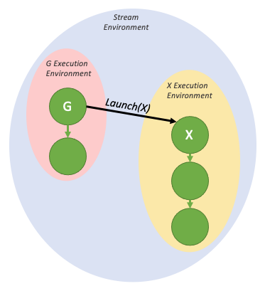

### [4.2.6.2. Device Launch](https://docs.nvidia.com/cuda/cuda-programming-guide/04-special-topics#device-launch)[](https://docs.nvidia.com/cuda/cuda-programming-guide/04-special-topics/#device-launch "Permalink to this headline")

Device graphs can be launched from both the host and the device via `cudaGraphLaunch()`, which has the same signature on the device as on the host. Device graphs are launched via the same handle on the host and the device. Device graphs must be launched from another graph when launched from the device.

Device-side graph launch is per-thread and multiple launches may occur from different threads at the same time, so the user will need to select a single thread from which to launch a given graph.

Unlike host launch, device graphs cannot be launched into regular CUDA streams, and can only be launched into distinct named streams, which each denote a specific launch mode. The following table lists the available launch modes.

| Stream | Launch Mode |
| --- | --- |
| `cudaStreamGraphFireAndForget` | Fire and forget launch |
| `cudaStreamGraphTailLaunch` | Tail launch |
| `cudaStreamGraphFireAndForgetAsSibling` | Sibling launch |

#### [4.2.6.2.1. Fire and Forget Launch](https://docs.nvidia.com/cuda/cuda-programming-guide/04-special-topics#fire-and-forget-launch)[](https://docs.nvidia.com/cuda/cuda-programming-guide/04-special-topics/#fire-and-forget-launch "Permalink to this headline")

As the name suggests, a fire and forget launch is submitted to the GPU immediately, and it runs independently of the launching graph. In a fire-and-forget scenario, the launching graph is the parent, and the launched graph is the child.


Figure 31 Fire and forget launch[](https://docs.nvidia.com/cuda/cuda-programming-guide/04-special-topics/#id13 "Link to this image")

The above diagram can be generated by the sample code below:

```cuda
__global__ void launchFireAndForgetGraph(cudaGraphExec_t graph) {
    cudaGraphLaunch(graph, cudaStreamGraphFireAndForget);
}

void graphSetup() {
    cudaGraphExec_t gExec1, gExec2;
    cudaGraph_t g1, g2;

    // Create, instantiate, and upload the device graph.
    create_graph(&g2);
    cudaGraphInstantiate(&gExec2, g2, cudaGraphInstantiateFlagDeviceLaunch);
    cudaGraphUpload(gExec2, stream);

    // Create and instantiate the launching graph.
    cudaStreamBeginCapture(stream, cudaStreamCaptureModeGlobal);
    launchFireAndForgetGraph<<<1, 1, 0, stream>>>(gExec2);
    cudaStreamEndCapture(stream, &g1);
    cudaGraphInstantiate(&gExec1, g1);

    // Launch the host graph, which will in turn launch the device graph.
    cudaGraphLaunch(gExec1, stream);
}
```

A graph can have up to 120 total fire-and-forget graphs during the course of its execution. This total resets between launches of the same parent graph.

##### [4.2.6.2.1.1. Graph Execution Environments](https://docs.nvidia.com/cuda/cuda-programming-guide/04-special-topics#graph-execution-environments)[](https://docs.nvidia.com/cuda/cuda-programming-guide/04-special-topics/#graph-execution-environments "Permalink to this headline")

In order to fully understand the device-side synchronization model, it is first necessary to understand the concept of an execution environment.

When a graph is launched from the device, it is launched into its own execution environment. The execution environment of a given graph encapsulates all work in the graph as well as all generated fire and forget work. The graph can be considered complete when it has completed execution and when all generated child work is complete.

The below diagram shows the environment encapsulation that would be generated by the fire-and-forget sample code in the previous section.


Figure 32 Fire and forget launch, with execution environments[](https://docs.nvidia.com/cuda/cuda-programming-guide/04-special-topics/#id14 "Link to this image")

These environments are also hierarchical, so a graph environment can include multiple levels of child-environments from fire and forget launches.


Figure 33 Nested fire and forget environments[](https://docs.nvidia.com/cuda/cuda-programming-guide/04-special-topics/#id15 "Link to this image")

When a graph is launched from the host, there exists a stream environment that parents the execution environment of the launched graph. The stream environment encapsulates all work generated as part of the overall launch. The stream launch is complete (i.e. downstream dependent work may now run) when the overall stream environment is marked as complete.


Figure 34 The stream environment, visualized[](https://docs.nvidia.com/cuda/cuda-programming-guide/04-special-topics/#id16 "Link to this image")

#### [4.2.6.2.2. Tail Launch](https://docs.nvidia.com/cuda/cuda-programming-guide/04-special-topics#tail-launch)[](https://docs.nvidia.com/cuda/cuda-programming-guide/04-special-topics/#tail-launch "Permalink to this headline")

Unlike on the host, it is not possible to synchronize with device graphs from the GPU via traditional methods such as `cudaDeviceSynchronize()` or `cudaStreamSynchronize()`. Rather, in order to enable serial work dependencies, a different launch mode - tail launch - is offered, to provide similar functionality.

A tail launch executes when a graph’s environment is considered complete - ie, when the graph and all its children are complete. When a graph completes, the environment of the next graph in the tail launch list will replace the completed environment as a child of the parent environment. Like fire-and-forget launches, a graph can have multiple graphs enqueued for tail launch.


Figure 35 A simple tail launch[](https://docs.nvidia.com/cuda/cuda-programming-guide/04-special-topics/#id17 "Link to this image")

The above execution flow can be generated by the code below:

```cuda
__global__ void launchTailGraph(cudaGraphExec_t graph) {
    cudaGraphLaunch(graph, cudaStreamGraphTailLaunch);
}

void graphSetup() {
    cudaGraphExec_t gExec1, gExec2;
    cudaGraph_t g1, g2;

    // Create, instantiate, and upload the device graph.
    create_graph(&g2);
    cudaGraphInstantiate(&gExec2, g2, cudaGraphInstantiateFlagDeviceLaunch);
    cudaGraphUpload(gExec2, stream);

    // Create and instantiate the launching graph.
    cudaStreamBeginCapture(stream, cudaStreamCaptureModeGlobal);
    launchTailGraph<<<1, 1, 0, stream>>>(gExec2);
    cudaStreamEndCapture(stream, &g1);
    cudaGraphInstantiate(&gExec1, g1);

    // Launch the host graph, which will in turn launch the device graph.
    cudaGraphLaunch(gExec1, stream);
}
```

Tail launches enqueued by a given graph will execute one at a time, in order of when they were enqueued. So the first enqueued graph will run first, and then the second, and so on.


Figure 36 Tail launch ordering[](https://docs.nvidia.com/cuda/cuda-programming-guide/04-special-topics/#id18 "Link to this image")

Tail launches enqueued by a tail graph will execute before tail launches enqueued by previous graphs in the tail launch list. These new tail launches will execute in the order they are enqueued.


Figure 37 Tail launch ordering when enqueued from multiple graphs[](https://docs.nvidia.com/cuda/cuda-programming-guide/04-special-topics/#id19 "Link to this image")

A graph can have up to 255 pending tail launches.

##### [4.2.6.2.2.1. Tail Self-launch](https://docs.nvidia.com/cuda/cuda-programming-guide/04-special-topics#tail-self-launch)[](https://docs.nvidia.com/cuda/cuda-programming-guide/04-special-topics/#tail-self-launch "Permalink to this headline")

It is possible for a device graph to enqueue itself for a tail launch, although a given graph can only have one self-launch enqueued at a time. In order to query the currently running device graph so that it can be relaunched, a new device-side function is added:

```cuda
cudaGraphExec_t cudaGetCurrentGraphExec();
```

This function returns the handle of the currently running graph if it is a device graph. If the currently executing kernel is not a node within a device graph, this function will return NULL.

Below is sample code showing usage of this function for a relaunch loop:

```cuda
__device__ int relaunchCount = 0;

__global__ void relaunchSelf() {
    int relaunchMax = 100;

    if (threadIdx.x == 0) {
        if (relaunchCount < relaunchMax) {
            cudaGraphLaunch(cudaGetCurrentGraphExec(), cudaStreamGraphTailLaunch);
        }

        relaunchCount++;
    }
}
```

#### [4.2.6.2.3. Sibling Launch](https://docs.nvidia.com/cuda/cuda-programming-guide/04-special-topics#sibling-launch)[](https://docs.nvidia.com/cuda/cuda-programming-guide/04-special-topics/#sibling-launch "Permalink to this headline")

Sibling launch is a variation of fire-and-forget launch in which the graph is launched not as a child of the launching graph’s execution environment, but rather as a child of the launching graph’s parent environment. Sibling launch is equivalent to a fire-and-forget launch from the launching graph’s parent environment.



Figure 38 A simple sibling launch[](https://docs.nvidia.com/cuda/cuda-programming-guide/04-special-topics/#id20 "Link to this image")

The above diagram can be generated by the sample code below:

```cuda
__global__ void launchSiblingGraph(cudaGraphExec_t graph) {
    cudaGraphLaunch(graph, cudaStreamGraphFireAndForgetAsSibling);
}

void graphSetup() {
    cudaGraphExec_t gExec1, gExec2;
    cudaGraph_t g1, g2;

    // Create, instantiate, and upload the device graph.
    create_graph(&g2);
    cudaGraphInstantiate(&gExec2, g2, cudaGraphInstantiateFlagDeviceLaunch);
    cudaGraphUpload(gExec2, stream);

    // Create and instantiate the launching graph.
    cudaStreamBeginCapture(stream, cudaStreamCaptureModeGlobal);
    launchSiblingGraph<<<1, 1, 0, stream>>>(gExec2);
    cudaStreamEndCapture(stream, &g1);
    cudaGraphInstantiate(&gExec1, g1);

    // Launch the host graph, which will in turn launch the device graph.
    cudaGraphLaunch(gExec1, stream);
}
```

Since sibling launches are not launched into the launching graph’s execution environment, they will not gate tail launches enqueued by the launching graph.
