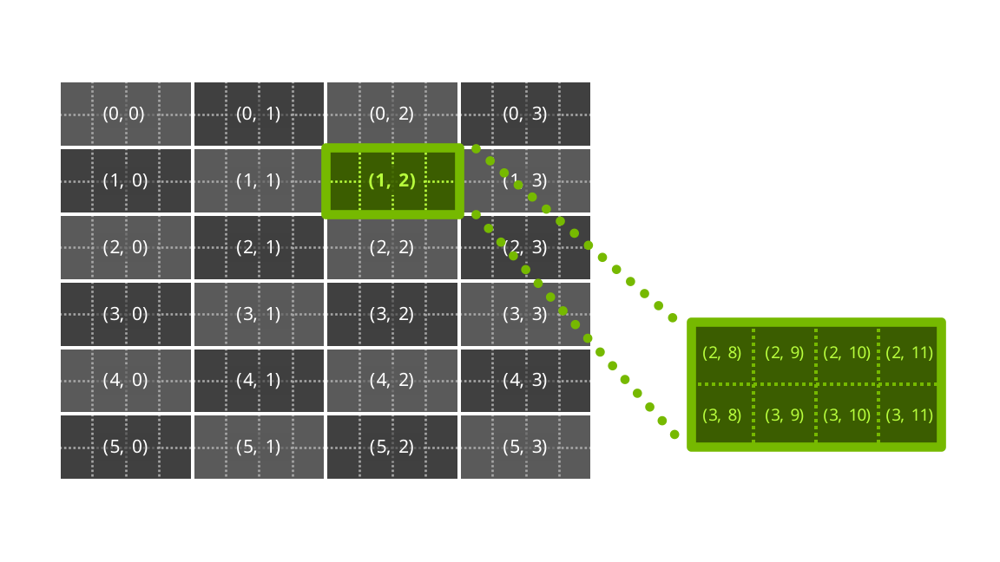
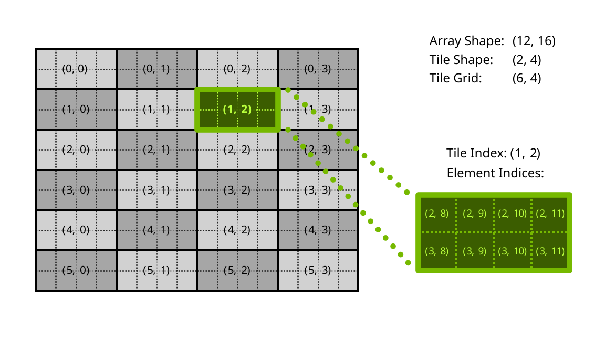
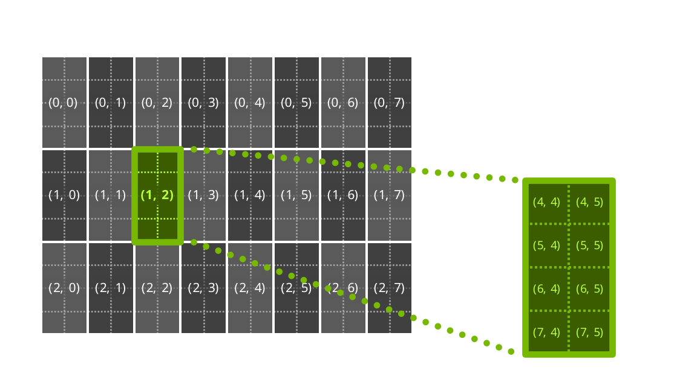
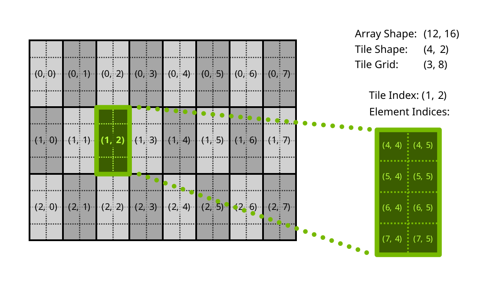

## [Element & Tile Space](https://docs.nvidia.com/cuda/cutile-python#element-tile-space)

The _element space_ of an array is the multidimensional space of its elements, stored in memory
according to a given layout (row-major, column-major, etc.).

The _tile space_ of an array is the multidimensional space of tiles of a given tile shape within
that array. A tile index `(i, j, ...)` with shape `S` refers to the elements belonging to the
`(i+1)`-th, `(j+1)`-th, … tile.

When accessing array elements via tile indices, the array’s multidimensional memory layout is used.
To access the tile space with a different layout, use the *order* parameter of load/store operations.
