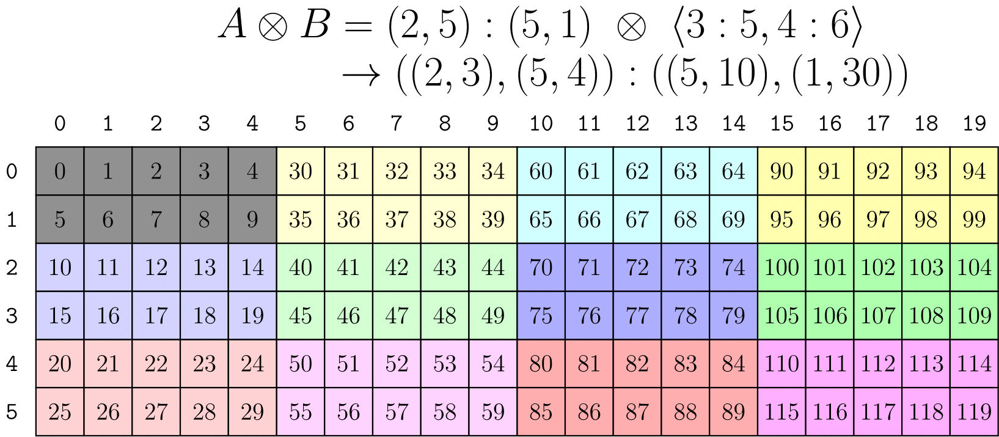
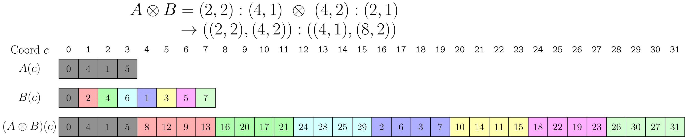

### [Logical Product 2-D Example](https://docs.nvidia.com/cutlass/latest/media/docs/cpp/cute#logical-product-2-d-example)[](https://docs.nvidia.com/cutlass/latest/media/docs/cpp/cute/#logical-product-2-d-example "Permalink to this headline")

We can use the by-mode `tiler` strategies previously developed to write multidimensional products as well.



The above image demonstates the use of a `tiler` to apply `logical_product` by-mode. Despite this **not being the recommended approach**, the result is a rank-2 layout consisting of 2x5 row-major block that is tiled across a 3x4 column-major arrangement.

The reason **this is not the recommended approach** is that the `tiler B` in the above expression is highly unintuitive. In fact, it requires perfect knowledge of the shape and strides of `A` in order to construct. We would like to express “Tile Layout `A` according to Layout `B`” in a way that makes `A` and `B` independent and is much more intuitive.

#### [Blocked and Raked Products](https://docs.nvidia.com/cutlass/latest/media/docs/cpp/cute#blocked-and-raked-products)[](https://docs.nvidia.com/cutlass/latest/media/docs/cpp/cute/#blocked-and-raked-products "Permalink to this headline")

The `blocked_product(LayoutA, LayoutB)` and `raked_product(LayoutA, LayoutB)` are rank-sensitive transformations on top of 1-D `logical_product` that let us express the more intuitive `Layout` products that we most often want to express.

A key observation in the implementation of these functions are the compatibility post-conditions of `logical_product`:

```console
// @post rank(result) == 2
// @post compatible(layout_a, layout<0>(result))
// @post compatible(layout_b, layout<1>(result))
```

Because `A` is always compatible with mode-0 of the result and `B` is always compatible with mode-1 of the result, if we made `A` and `B` the same rank then we could “reassociate” like-modes after the product. That is, the “column” mode in `A` could be combined with the “column” mode in `B` and the “row” mode in `A` could be combined with the “row” mode in `B`, etc.

This is exactly what `blocked_product` and `raked_product` do and it is why they are called rank-sensitive. Unlike other CuTe functions that take `Layout` arguments, these care about the top-level rank of the arguments so that each mode can be reassociated after the `logical_product`.



The above image shows the same result as the `tiler` approach, but with much more intuitive arguments. A 2x5 row-major layout is arranged as a tile in a 3x4 column-major arrangement. Also note that `blocked_product` went ahead and `coalesced` mode-0 for us.

Similarly, `raked_product` combines the modes slightly differently. Instead of the resulting “column” mode being constructed from the `A` “column” mode then the `B` “column” mode, the resulting “column” mode is constructed from the `B` “column” mode then the `A` “column” mode.


This results in the “tile” `A` now being interleaved or “raked” with the “layout-of-tiles” `B` instead of appearing as blocks. Other references call this a “cyclic distribution.”
