## 1. Overview

If we compress nearly two decades of NVIDIA GPU architectural evolution into a single sentence, the central thread is that **the execution domain, the data-supply domain, the synchronization domain, and the cooperation boundary keep expanding outward**; feature stacking is only the surface phenomenon.

The earliest machine looked roughly like this:

-   Execution: `warp lockstep` was the default forward-progress model
-   Data supply: a near-execution chain organized as `RF -> collector -> ALU`
-   Synchronization: register dependencies, `busy-bit / scoreboard` ready states, and issue stall / restart conditions inside the `SM`
-   Cooperation: a single `SM` was the default boundary for hardware cooperation and shared state
-   The `memory-side` (i.e., the `L2 / partition / DRAM` side) and the interconnect already existed, but did not yet carry today's strong software-visible semantics

Each subsequent architectural breakpoint that mattered broke at least one of those boundaries:

-   **Fermi**'s breakpoint was that cache policy for `global` accesses, the per-address mapping into `L2 / partition` processing domains, and parts of atomic / ordering behavior began to become software-observable, software-tunable memory-side boundaries.
-   **Volta**'s breakpoint was that the general-purpose path lost its monopoly, and implicit warp lockstep ceased to be a default precondition.
-   **Hopper**'s breakpoint was that shared-memory-style CTA cooperation crossed the single-`SM` boundary for the first time, expressed as an explicit set of hardware primitives: `Thread Block Cluster / DSM / TMA`.

This document is organized around three questions, focusing not on what each generation added but on: **where did the previous generation get stuck, what mechanism did the next generation introduce, and where did that mechanism push the new contradictions?**

The evidence is read in three layers: facts that can be confirmed in official public documentation, patent text, and inductions stitched together from the first two. When this document discusses an "evolutionary line of thought," it refers to the architectural pressure chain jointly supported by all three sources, and is not equivalent to any internal design roadmap that NVIDIA has officially declared.

Read this way, the main thread of the past two decades can be summarized as three layers of pressure:

-   **Memory-side control / semantics pressure**: when `L2`, atomic, residency, and coherence are promoted from background details, the memory side must become a real hardware domain.
-   **Datapath specialization pressure**: when matrix computation, low-bit formats, and warp-uniform data flows can no longer be stuffed into the same general-purpose path, execution and data supply must split.
-   **Coordination pressure**: once `cp.async`, `TMA`, `WGMMA`, and cluster cooperation become the leading roles, synchronization primitives and interconnect boundaries must be upgraded along with them.

  

## 2. Evolutionary Line of Thought: From the Baseline Machine to a Cluster-Scale Cooperative Execution Domain

### 2.1 Tesla: defining the original general-purpose, lockstep, single-`SM`-as-primary-boundary machine

Tesla first nailed down a few of the most important boundaries:

-   `US8539130B2` (priority 2009-09-24) shows that an off-core `crossbar` with virtual channels was already taking shape, indicating that on-chip traffic organization was not a later add-on.
-   `US7339592B2` (filed 2004) and `US7490208B1` (filed 2004) provide the early-stage origin for multi-ported `RF` and operand-supply structures (the former simulating multi-ported memory via banks plus a collector unit; the latter implementing a compact multi-ported register file with phase-multiplexed single-port RAM), indicating that local data supply organized close to the execution units existed very early.
-   `SIMT + warp` lockstep advancement, together with the per-`SM` aggregation of shared memory / scoreboard / execution, formed the default execution model of this initial machine.

Looking at the machine skeleton, Tesla had already laid out the relationships among `SM`-local execution, off-core `crossbar`, and the memory-side path; the later discussion of `virtual channels` only unfolds the "how on-chip traffic is organized" piece of that.

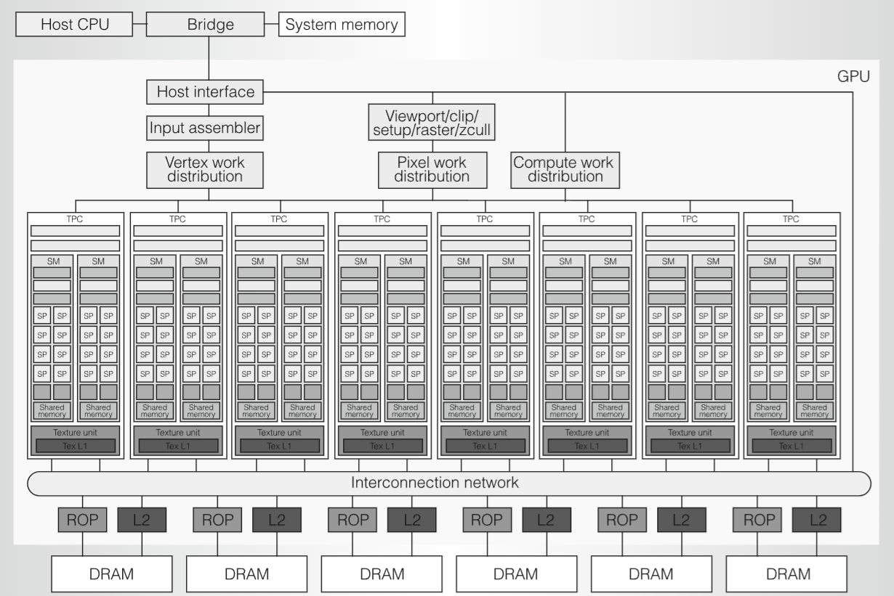

Here, `virtual channels` means: on the same off-core `crossbar` / on-chip fabric, the shared physical channel is partitioned by `traffic class` into logically isolated channels or queues; the physical wires still share the same set of underlying lanes. The core contradiction it addresses is: when `compute`, `memory`, and `graphics`-class requests share a switching plane, how do we classify, queue, arbitrate, and propagate backpressure so that one class of traffic does not stall the others.

```text
+------------------------------------------------------------+
| one physical crossbar/link, multiple logical channels      |
| VC-compute  --\                                            |
| VC-memory   ---+--> [ arbitration / shared switch ] -> out |
| VC-graphics --/                                            |
+------------------------------------------------------------+
```

So when this document says "on-chip traffic organization," it means: how off-core requests in the `SM/GPC -> crossbar -> partition/L2/memory interface` layer flow inside the chip — who shares which links, which traffic needs logical isolation, along which path stalls propagate back, and how the system maintains usable throughput within finite area and power budgets. `virtual channels` is just one mechanism within that organizational problem; the bigger problem is that from the very beginning a GPU needs a unified switching layer that can simultaneously carry multiple clients, multiple destinations, and multiple request classes.

```text
+---------------------------------------------------------------------------+
| request sources -> on-chip fabric -> memory-side destinations             |
| SM0   --\                                                                 |
| SM1   ---+--> [ crossbar / fabric ] --> [ partition0 ] -> [L2_0] -> DRAM0 |
| GPC_A ---+--> [ crossbar / fabric ] --> [ partition1 ] -> [L2_1] -> DRAM1 |
| GPC_B --/               |                                                 |
| busy destination <------+----- backpressure / queue state upstream        |
+---------------------------------------------------------------------------+
```

This is also why on-chip traffic organization was already a concern as early as Tesla. From the first general-purpose GPU onwards, many requests from different sources travel over the same on-chip switching plane: multiple `SM/GPC`s contend concurrently for shared `memory-side` resources, graphics and compute traffic may coexist, and the chip cannot afford a separate interconnect for every traffic class. The first thing that must be solved is therefore: "with so many concurrent requests on the road, how do we split, queue, prioritize on conflict, and avoid one stalled downstream dragging everyone else with it?" Without early traffic-classification and isolation mechanisms, a shared `crossbar` quickly becomes a chip-wide bottleneck due to `head-of-line blocking`, port contention, and backpressure propagation.

`head-of-line blocking` here can be read directly as: the head-of-queue request cannot leave because its destination is busy, so subsequent requests that could in principle make progress to idle destinations cannot bypass it, since they share the same `FIFO` or the same arbitration entry. The point is "once the head stalls, it drags along the requests behind it that would otherwise have made progress," even if not all destinations are busy.

```text
+------------------------------------------------------------------+
| head-of-line blocking                                            |
| head -> [A: busy dest] [B: free dest] [C: free dest]             |
| A cannot leave first, so B/C cannot bypass it in one FIFO        |
| later requests are blocked by the stalled front request          |
+------------------------------------------------------------------+
+-----------------------------------------------------------------+
| without traffic organization                                    |
| SM0(mem)  --\                                                   |
| GPC(gfx)  ---+--> [ one shared queue ] --> [ busy destination ] |
| SM1(comp) --/                                                   |
| all unrelated traffic waits behind the blocked head entry       |
| with virtual channels                                           |
| SM0(mem)  ----> [ VC-memory   ] --> memory path                 |
| GPC(gfx)  ----> [ VC-graphics ] --> graphics path               |
| SM1(comp) ----> [ VC-compute  ] --> compute path                |
+-----------------------------------------------------------------+
```

Pushing this mechanism one step closer to hardware: think of it as splitting the input port into multiple logically isolated queues, then sharing the downstream switching resources via arbitration. When one direction or one class of traffic temporarily stalls, only the corresponding queue is jammed, and other requests on the same input port that could still advance still have a chance to bypass the stall.

Tesla's representative product `G80` was launched in `2006`, while `US8539130B2` cited here has a priority date of `2009`. So we use it only as evidence for the following claim: at the latest by Tesla, NVIDIA had already formalized off-core `crossbar + virtual channels` as a recognized architectural problem; this is enough to support the judgment that "on-chip traffic organization was a foundational problem from very early on," but it does not by itself prove that `G80` had publicly adopted an implementation with the same name and same shape.

  

### 2.2 Fermi: the memory-side turned from passive cache background into a tunable processing domain

The real limits in the Tesla era came from both cache capacity and memory-side semantic boundaries: the memory side was more like a background path of "where does an address request finally land," and was not yet a stable software-visible control boundary. In other words, the main contradiction in this section is not the `SM`-local execution structure, but the absence of a clean software interface for controlling or interpreting cache behavior, write-back paths, and atomic execution location.

Viewed from the `SM`-local execution perspective, Fermi is still primarily a single-`SM` machine driven by a dual warp scheduler and instruction dispatch; this in fact emphasizes that the real turning point of this generation is not execution-domain expansion, but that the memory-side control point was written, for the first time, into a stable hardware boundary.

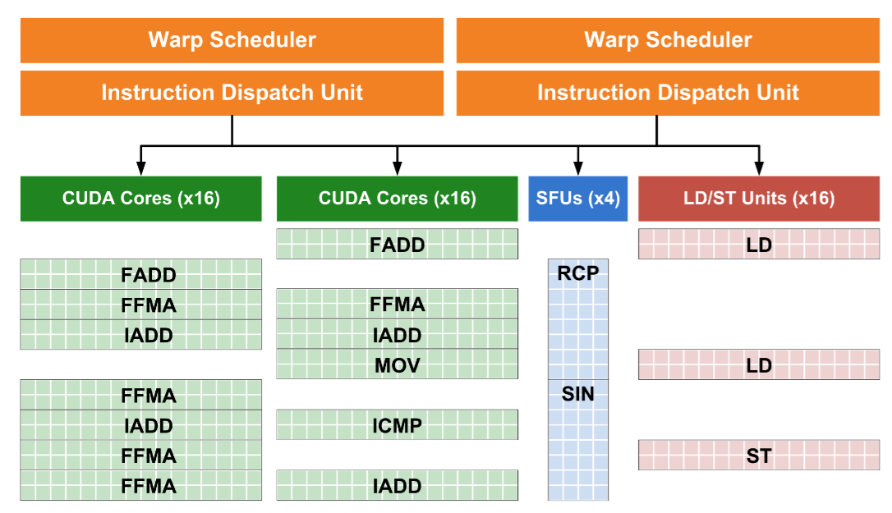

  

Fermi pushed part of the control point onto the memory side for three direct reasons.

1.  `global` accesses are no longer just "send the address to DRAM and pull the data back." Software has begun to need to distinguish which accesses should aggressively use the cache, which are merely streaming data, which accesses want to weaken local copies and refetch, or take a write-through-style path.

2.  Leaving these decisions on the SM/L1 side is unstable, because L1 is local to each SM and cannot serve as a common processing point when different SMs access the same global address. Without a common memory-side owner closer to L2/partition/DRAM — that is, the L2 slice / partition processing domain that the address maps to — programs cannot stably reason about where an access is processed, how it is cached, or how it flows into the backing store.

3.  As atomics, write-backs, residency, and stronger synchronization needs emerge, the hardware also needs a stable per-address landing point so that ordering decisions, backpressure, cleanup, and completion paths do not have to sit at a higher level doing fuzzy coordination.

`US9639479B2` (priority 2009-09-23, filed 2010-09-22) is the first key turning point on this line. Its importance lies in fixing the following items into the same set of hardware boundaries, rather than the mere fact of introducing `L2`:

-   `partition unit`
-   `L2 slice`
-   `FB DRAM interface`
-   `.cg / .cs / .cv / .wt` and similar load/store policy modifiers

Here, `FB DRAM interface` can be read directly as the interface boundary from this memory-side partition out to external `DRAM`; together with the `L2 slice`, it nails the `partition -> L2 -> DRAM` path into a complete local memory-side processing domain. The `FB DRAM interface` itself does not act as a new cache layer.

The middle term `global load/store` here refers to the global-address access itself, and does not name an independent hardware node. For these `global load/store` accesses, cache policy, write-back path, and per-address ownership are migrating from the more local `SM/L1` viewpoint to the memory-side owner where `L2 slice + policy + order` reside.

From here on, `L2` is upgraded from a passive large cache into a software-aware, cache-policy-tunable memory-side domain whose residency and write-back policy can be reasoned about. Fermi's key contribution is establishing for `global` accesses a per-address processing domain independent of the issuing `SM`: the same global address is no longer mainly determined by some local `SM/L1` of the issuing thread, but stably falls into the `L2 slice / partition` it maps to, where cache policy, atomic ordering, write-back timing, and completion path are handled.

"Stable" here means a stable processing domain: regardless of which `SM` originates the request, the same global address lands in a consistent memory-side processing domain. It does not guarantee an L2 hit, does not imply that all data permanently sits in `L2`, and does not endow cache operators with synchronization semantics. For example, when one `SM` writes a completion flag and another `SM` later polls it, the program must still use the correct fences, atomics, barriers, or CUDA/PTX memory-model mechanisms to express visibility. But the hardware needs a common location to handle questions like: has the write completed, do stale local copies need to be weakened, who wins on same-address atomics, when can the result be delivered to other observers?

The hardware sees only an address stream, but the software knows access intent: will this data be reused soon, is this just a sequential scan-once pass, should this access avoid polluting local caches, would this store be better off on a write-through-style path? It is exactly because of this asymmetry that software begins to distinguish ordinary cache accesses from streaming data; otherwise a one-shot scan over a large input block evicts the truly hot reusable data from `L2`, while accesses that need a special cache path get mixed with ordinary accesses, hurting both performance and explainability.

`.cg / .cs / .cv / .wt` encodes such access intent as a cache policy / locality hint. Important caveat: these modifiers affect cache path, eviction tendency, or fetch location, but in the official PTX semantics cache operators are performance hints and do not alter memory-consistency behavior; true synchronization and visibility are still carried by the CUDA/PTX memory model, barriers, fences, atomics, etc. The examples below are only meant to build intuition and do not cover all use cases:

| Modifier | Semantics | Suitable accesses | Example |
| --- | --- | --- | --- |
| .cg | Prefer caching at the global / L2 level, do not preferentially occupy each SM's L1 | Want to avoid local L1 copies interfering, but still want to use shared L2 | Multiple blocks repeatedly read the same parameter or lookup table; want it shared in L2 instead of duplicated per-SM L1 |
| .cs | "Streaming" — even if cached, prefer to evict early | Single-use, sequentially scanned, low-reuse streaming data | One-shot scan of a long input sample, pixel stream, or activation tensor that won't be re-read soon |
| .cv | For system-memory-related accesses, prefer to refetch and reduce reuse of possibly-stale lines | Reduce risk of stale-line hits, but not as a synchronization primitive | Reading data that may be updated by host or external agents, paired with proper synchronization |
| .wt | Write-through-style store, prefers pushing the write toward memory side / system memory | Avoid long-lived local dirty state, but still not a substitute for release/fence | Writing host-mapped buffers, mailboxes, or queue metadata, paired with the correct memory-ordering primitives |

Many of today's seemingly more modern themes can be traced back to early motivations here:

-   `US9639466B2` (filed 2012-10-30) further pushes the question of when `L2` dirty data becomes visible to the backing store / `DRAM`, and when cleanup and backpressure are triggered.
-   Ordered atomic also descends along this path: the same address first stably lands in some `L2 slice`, and that slice handles ordering, waiting, and execution, avoiding fuzzy global coordination at higher layers.
-   `residency control` begins to answer: which data should preferentially stay in `L2`, and which can be evicted faster under ordinary or streaming policies.
-   `memory synchronization domains` begin to answer: which class of memory effects and which class of observers should a barrier / fence apply to, instead of forcing the entire memory world to wait by default.
-   The broader coherence / completion visibility line begins to answer: even after entering the coherent domain, when does a remote write actually become visible to another observer.

Fermi's true contribution is to **rewrite the visible control boundary on the memory side**: many problems that previously could only be vaguely handled on the `SM` side begin, from here, to be discussed independently around `L2 / partition`.

After Fermi, **Kepler and Maxwell are more like the evolution of this same line.**

-   Kepler completed the `RF -> crossbar -> collector` data-supply loop along one axis: banked `RF` first reads source operands distributed across different register banks, the `crossbar` routes them to the `collector`, and the `collector` accumulates and reuses operands close to the datapath, so the operator entry doesn't have to re-read from `RF` every time. The `collector` here is more like an operand-staging / reuse layer near the operator entry, not a second `RF`.
-   Maxwell pushed synchronization from busy-bit toward barrier-style along another axis. `US9612836B2` (filed 2014) for software scoreboard and `US10067768B2` (earliest priority 2014-07-18) for convergence barrier together prepared the execution protocol that Volta would later need. "Earliest priority date" here refers to the earliest traceable filing date in a patent family, used to estimate the time window of when a technical idea appeared; it is not the publication or grant date. A first-cut reading: the point of software scoreboard is to push "which dependency must this instruction wait on" from implicit hardware decision into a software/compiler-explicit wait object; the point of the convergence barrier is to push "how do post-divergence threads reconverge" from the early implicit `active mask + token stack` mechanism into an explicit barrier-style mechanism: threads entering the divergence region register on the barrier first, the threads that reach the convergence point earlier wait there, threads that arrive later continue executing, and once all participating threads have arrived, they all resume together. In other words, the hardware saves "who is waiting, on which barrier, and from which `PC` to resume after the condition is met" as explicit state, instead of leaving it implicit in a control-flow stack. One step further into implementation: think of it as the hardware maintaining a barrier-state record; when a thread enters the divergence region, it registers itself via `ADD`; at the convergence point it executes `WAIT` and becomes blocked, while the hardware saves the resume `PC`; the scheduler each cycle picks only the subset of threads whose current barrier condition allows progress, and once the barrier judges that all participating threads have arrived, it lifts the wait at once.
-   Reference article on software-scoreboard design:

[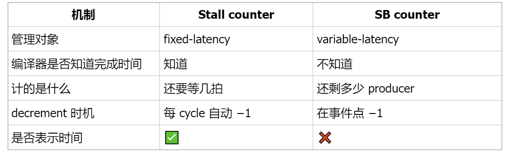 "In-depth analysis of Modern GPU control-bits design" — 134 likes · 12 comments](https://zhuanlan.zhihu.com/p/1985083294845510474)

In other words, Fermi pushed semantics onto the memory side; Kepler and Maxwell cleaned up data-supply and synchronization on the `SM` side. Only after this did the conditions for the next, larger structural rewrite ripen.

### 2.3 Volta: the general-purpose path loses its monopoly, and implicit warp lockstep gets rewritten

Volta is the second key rewrite, restructuring two lines simultaneously.

The first key rewrite is in execution-path organization. `US10338919B2` (priority 2017-05-08, filed 2017-11-29) directly draws a new data-supply and execution path into hardware reality:

`register bank -> crossbar -> operand collectors -> HMMA datapath -> result queue`

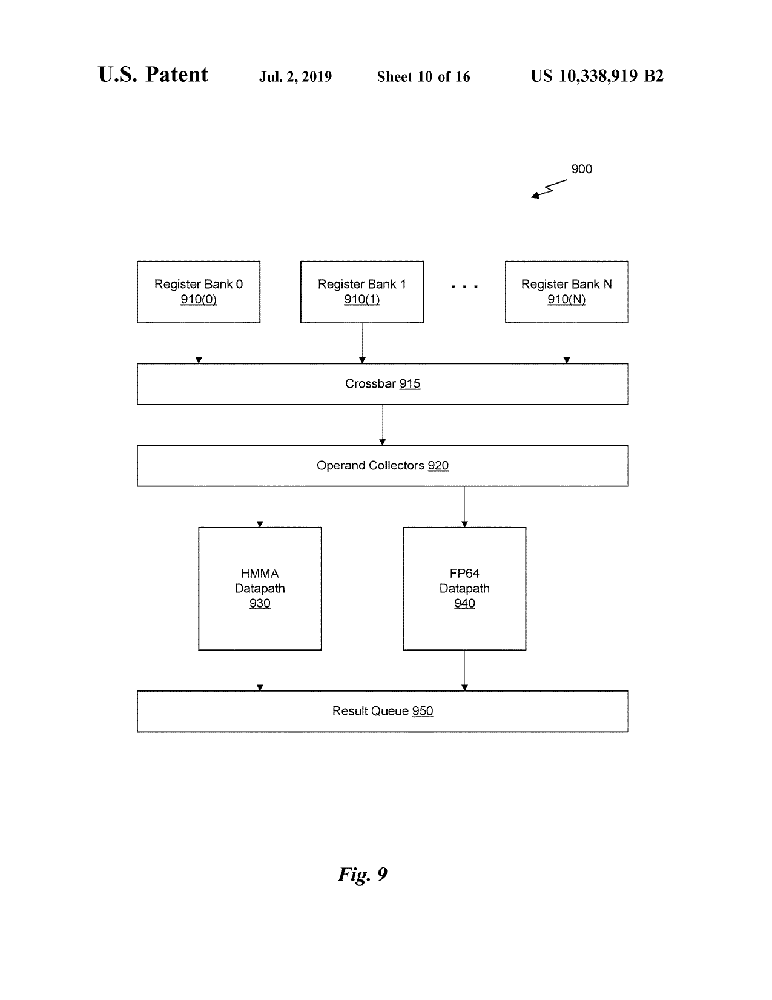

Per the patent, the design of the `HMMA datapath` can first be compressed into a simple model:

```text
RF banks
  -> crossbar
  -> operand collectors
  -> HMMA datapath
  -> result queue
  -> RF writeback
```

The key point of this chain is to relayer the "fetch, reuse, execute, write back" of matrix operations. `RF banks` are still the source of thread registers, but their read bandwidth is limited; one cannot freely re-read entire `A/B/C` blocks for every dot-product sub-step at no cost. The `crossbar` routes values that have been read out of the register banks to the appropriate `operand collectors`. `operand collectors` are a vector staging layer near the datapath entry, not a second general-purpose register file: the patent text explicitly describes them as a structure that can preload operands from `RF` over multiple clock cycles and then feed the datapath in parallel during one `MMA` execution. This way, the same `A/B` vectors can be reused across multiple dot-product passes, instead of having to go back through `RF -> crossbar` for each pass.

The real `HMMA datapath` then consumes these positioned vectors and produces multiple elements of the result matrix. `Fig. 7` explains that matrix multiply-accumulate essentially combines row/column vectors of the input matrices into multiple dot-products; the subsequent datapath figures show several implementation options: producing multiple dot-products in parallel within one pass, or reusing the vector combinations in the collectors across multiple passes. Results enter the `result queue` first and wait for the right moment to be written back to the banked `RF`, which means writeback itself also requires arbitration and buffering — completion of the datapath does not necessarily mean immediate writeback.

There is one boundary to make explicit: this patent does not prove that `HMMA` is fully detached from the original floating-point machine. `Fig. 9` draws both `HMMA datapath 930` and `FP64 datapath 940`, and they share `operand collectors` and the `result queue` in the figure; `Fig. 14` further says some HMMA implementations may share part of the pipeline stages with the double-precision FMA datapath. So a more accurate reading is: Volta specializes the front and middle segments of the matrix dot-product, but data supply, completion, and writeback structures are not all rebuilt. The patent is enough to support the main chain `RF -> crossbar -> collectors -> HMMA -> result queue`, but not enough to write Volta's warp/lane fragment mapping, collector allocation policy, or per-stage internal pipeline timing as a definitive answer.

Reference article on the specific design:

[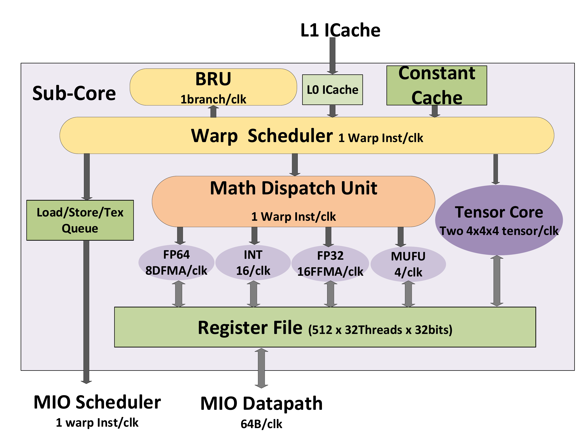 "In-depth Analysis of Tensor Core Microarchitecture" — 201 likes · 10 comments](https://zhuanlan.zhihu.com/p/2028548125518755193)

The implication is far-reaching. Volta keeps the original general-purpose path and at the same time gives matrix multiply-accumulate its own dedicated path with a separate entry, separate middle stages, and separate result-flow organization, instead of being just one mode squeezed into the general-purpose floating-point pipeline. The subsequent `BF16`, `TF32`, `FP8`, and `FP4` evolution all descend along this branch that has been split off.

Why must it be done this way? Because matrix multiply-accumulate is no longer a good fit for being stuffed into the same general-purpose `FPU` path as ordinary scalar/vector floating-point. It has three additional pressures:

First, matrix multiply-accumulate repeatedly performs many dot-products on a fixed tile, with throughput targets far higher than ordinary `FMA`. If it still shares the same execution path with general-purpose operators, the general path easily becomes both starved and clogged.

Second, its data-supply pattern is different; matrix block data needs to be staged in groups near the `operand collector` and reused across multiple internal sub-computations of the `HMMA datapath`, instead of going back through general registers / crossbar at each step. "Multiple internal sub-computations" can be read as: a single matrix-tile op breaks a set of `A/B` matrix fragments into multiple dot-products or micro-ops to accumulate the result, and the same input fragment is read multiple times across these sub-steps; staging it near the Tensor Core entry is more reasonable than re-accessing `RF -> crossbar` at every sub-step.

Third, its numeric type is starting to clearly diverge from general-purpose floating-point. Volta's first-generation Tensor Core uses `FP16 input + FP32 accumulate`, which is already more like a dedicated compute path than an extra mode added to the general `FPU`. That is why Volta pulls matrix multiply-accumulate out into its own `HMMA datapath`: this both lifts the matrix throughput ceiling and reserves a stable extension point for the subsequent format evolution into `BF16`, `TF32`, and `FP8`.

The second key rewrite is in the execution model. Volta keeps the warp object itself, while changing implicit lockstep advancement from a default precondition to an execution semantics that can be explicitly broken and recomposed. **Threads can no longer be understood only as a warp unit that is by default neatly synchronized and advances together; divergence, waiting, and forward progress all begin to become finer-grained hardware objects.**

"Implicit warp lockstep" must be unpacked. `Warp lockstep` refers to: in Pascal and earlier execution models, active threads in the same warp share by default a single forward-progress point and control-flow state; on divergence, the `active mask + reconvergence stack` serializes the different paths and reconverges at hardware-determined merge points. `Implicit` refers to the fact that this "threads in the same warp arrive together, advance together, converge together" feeling is provided by hardware default — the program does not need to explicitly issue a barrier each time.

The two diagrams below directly contrast before and after this rewrite:

**Before Volta: implicit warp lockstep**

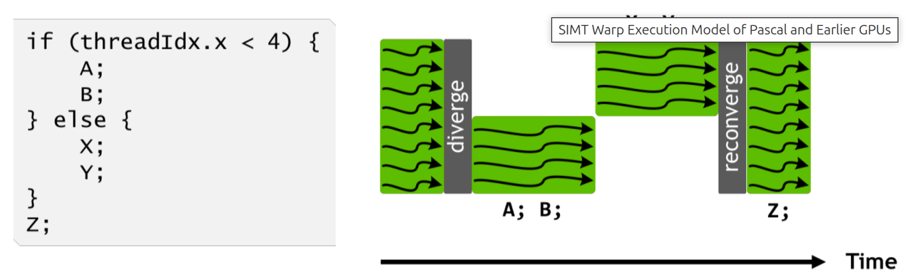

**After Volta: execution split under ITS**

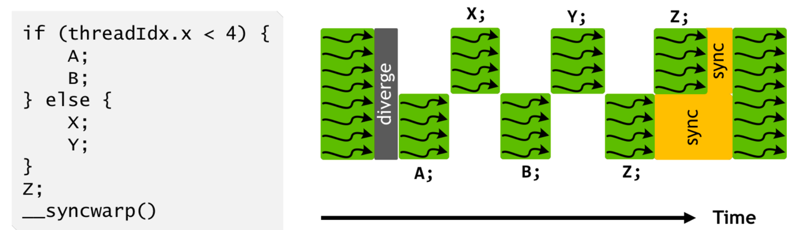

So the change Volta brings is more than a more flexible scheduler; the default execution semantics are also rewritten: a single warp is no longer naturally equivalent to "all threads are at the same `PC` right now." This is also why the later `_sync` family and `__syncwarp()` matter; they essentially tell the hardware: this time I require which set of threads to explicitly meet at the same convergence point and make joint progress.

Reference article on the design here:

[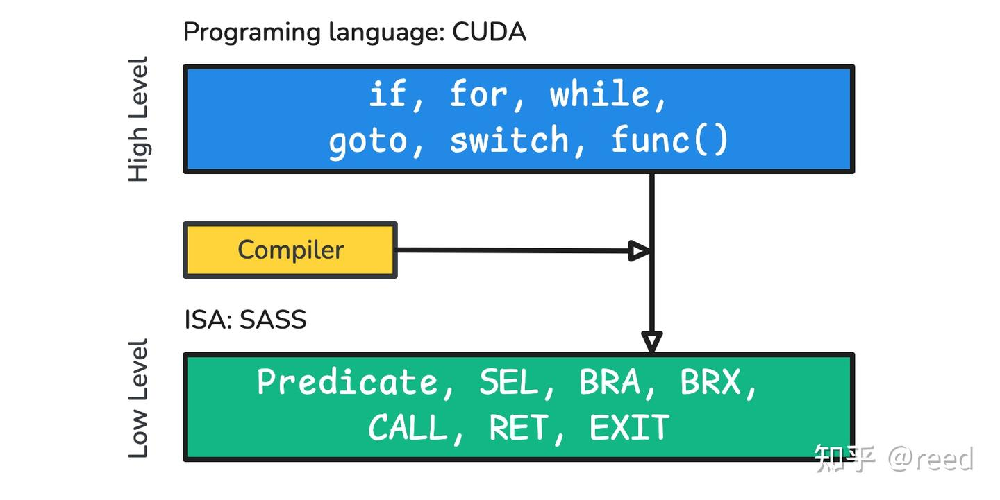 "Modern GPU Control-flow Design" — 95 likes · 3 comments](https://zhuanlan.zhihu.com/p/1985794546739720618)

So Volta's key is to rewrite two more fundamental things at once:

-   The hardware begins to split paths by data form; the general-purpose compute path no longer monopolizes all major operators.
-   The hardware begins to split paths by execution form; implicit warp lockstep is no longer the default precondition.

There is a commonly misunderstood point: "splitting paths by data form" is not the same as simply hard-splitting the register file into two sets along `FP` and `INT` lines. For most ordinary thread-private values, sharing a general `RF` is still more reasonable, because integer address computation, bit operations, and floating-point computation are usually interleaved in real code; forcibly splitting purely by numeric type makes compiler shuffling, port balancing, and writeback pressure harder to handle. What is really worth a separate split is usually determined by "how it is consumed": warp-uniform values are better served by a `URF/UDP` path that stores one copy and supports broadcast read; matrix tiles and accumulators are better served by an `HMMA`-class dedicated datapath; barrier/predicate-class control state is better placed in a small, dedicated state store. In other words, the hardware should split paths by "how the data is reused, broadcast, accumulated, and consumed," not just by storage type.

After Volta, Turing and Ampere are more like the phase that matures and stabilizes these new mechanisms.

-   Turing officially forks the precision line into `INT8/INT4`, indicating that the Tensor Core is no longer just a half-precision training accelerator but is starting to form an independent inference branch.
-   Ampere fixes the asynchronous transport and format expansion that were faintly visible in the Volta era into stable mechanisms: `cp.async`, `BF16/TF32`, and structured sparsity appear together, indicating that the post-split machine has entered the "how to feed and stabilize" phase. Patent material also describes a `shard scheduling` idea that interleaves forward progress by thread subset within a warp post-divergence; this can be cited as additional evidence that fine-grained scheduling continues to descend, but in this document it should be read as a patent-side inference, not equated with publicly stated official features like `cp.async / TF32 / BF16`.

Reference for cp.async patent analysis:

[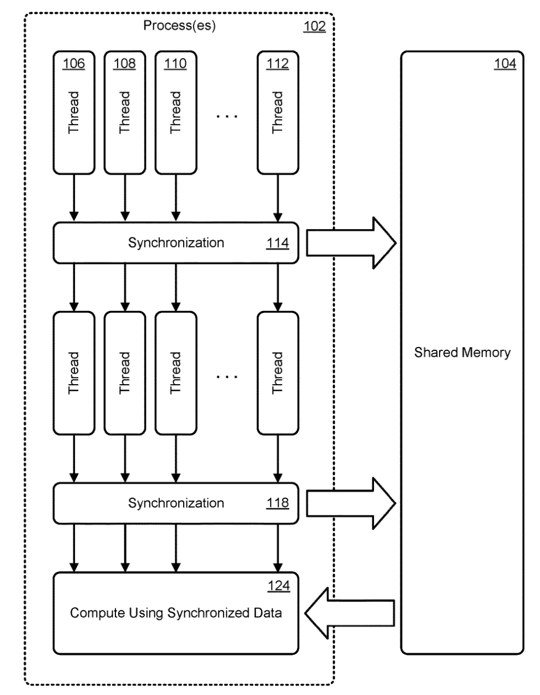 "NVIDIA cp.async Patent Analysis" — 79 likes · 1 comment](https://zhuanlan.zhihu.com/p/1991959111676471249)

### 2.4 Hopper: cluster-scale cooperation becomes an explicit hardware execution domain

Volta to Ampere solved how to split paths, transport, and wait inside a single `SM`. Hopper pushed shared-memory-style CTA cooperation up to the next level: **how multiple `SM`s share data, wait on transactions, and consume jointly via cluster-scale hardware primitives.**

Looking at the official `H100 SM` diagram, the easy reading is that Hopper just strengthens the per-`SM` `Tensor Core`, `FP32/INT`, `LD/ST`, `L1/SMEM`, scheduler, and register resources — but the full problem already extends beyond a single `SM`. The real new pressure is: inside a single `SM`, matrix operators, async copy, and waiting mechanisms are already organized very tightly, and the next bottleneck becomes **how multiple `SM`s share a working set and let data transport and matrix consumption close the loop across a larger execution domain.**

But Hopper's architectural innovation does not live only in the single-`SM` diagram; it lives in how the single-`SM` design is placed inside a cluster-scale cooperation framework.

That is why Hopper's core cannot be reduced to a feature checklist. What really matters is that the following five interfaces form a closed loop:

-   **Numerical contract**: `FP8 (E4M3 / E5M2) + Transformer Engine` ties low-bit format selection, scale management, and matrix operators together
-   **Consumer granularity**: `WGMMA` pushes the matrix consumer side from a single warp to a warp group
-   **Transport path**: `TMA` moves address generation and transport for large multi-dimensional tensor tiles out of thread loops onto a dedicated hardware path
-   **Shared scope**: thread block clusters and `DSM` extend shared-memory-style cooperation from a single `SM` to a group of co-scheduled `SM`s
-   **Async and barriers**: transaction-aware barriers wait not only on thread arrival but also on the arrival of data-transport transactions
-   `US20230289189A1` (filed 2022-03-10) extends the effective scope of shared memory from a single `SM` to a cluster, forming `DSM`
-   `US12141082B2` (filed 2022-03-10) takes large tile transport off the traditional LSU pass-through path, forming `TMA`
-   `US20230289242A1` (filed 2022) makes the barrier wait not only on threads but also on transaction arrival
-   `WGMMA` pushes the consumer side from a single warp to a warp group

The official CUDA programming model also states this boundary change very directly: [compute capability 9.0 introduces thread block clusters](https://docs.nvidia.com/cuda/cuda-c-programming-guide/index.html#thread-block-clusters), where thread blocks within a cluster are guaranteed to be co-scheduled on one `GPC` and can access [distributed shared memory](https://docs.nvidia.com/cuda/cuda-c-programming-guide/index.html#distributed-shared-memory). In other words, what Hopper adds is a new locality / cooperation tier, beyond "more shared memory": previously, blocks defaulted to exchanging state through global memory or coarser kernel boundaries; at the cluster level, multiple blocks can synchronize within a hardware-guaranteed co-residency scope and directly read/write each other's shared-memory partitions.

"Shared" here should be read as distributed sharing, not misread as all blocks sharing one big un-owned shared memory. Each thread block still owns its own per-block shared memory partition, with capacity declaration and lifetime still scoped to the block; what `DSM` does is map these partitions within a single cluster into an address space that can be accessed across blocks. For example, `Block 0` can write a tile into its own shared memory; `Block 1`, after cluster synchronization, can read that partition through `DSM` and even atomically update data inside it; but if `Block 0` has already exited, other blocks should no longer access its shared-memory partition. So the key point of `DSM` is to provide a hardware-guaranteed near-end shared view among blocks within a cluster, not to physically merge shared memory.

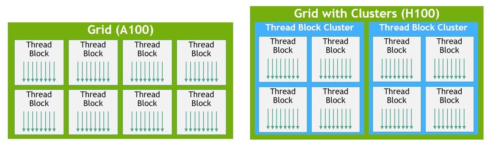

The left side is still the traditional grid -> thread block; the right side adds a thread block cluster tier. This tier is the prerequisite for understanding `DSM`, cluster barriers, and `WGMMA`-related cooperation.

`TMA` solves the data-supply path. Ampere's `cp.async` already lets global -> shared copy be asynchronous, but much of the address generation, loop tiling, and copy choreography is still carried out by threads. Hopper's `TMA` puts dimensions, strides, bounds, and layout of the tensor tile into a descriptor; one initiating thread submits a large async transport, and subsequent address generation and data movement are handled by hardware. The point of doing this is to free producer threads from piecewise transport, so the matrix main loop can be scheduled around large-tile production, waiting, and consumption — not just to make a single copy instruction faster.

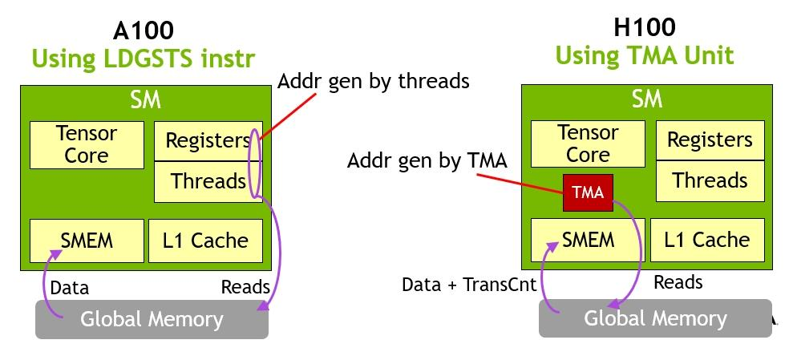

The above shows: Hopper moves responsibility for tile-copy address generation and transport from thread loops into `TMA`, providing a clearer producer event for the subsequent barrier and `WGMMA` consumption.

Reference for TMA patent analysis:

[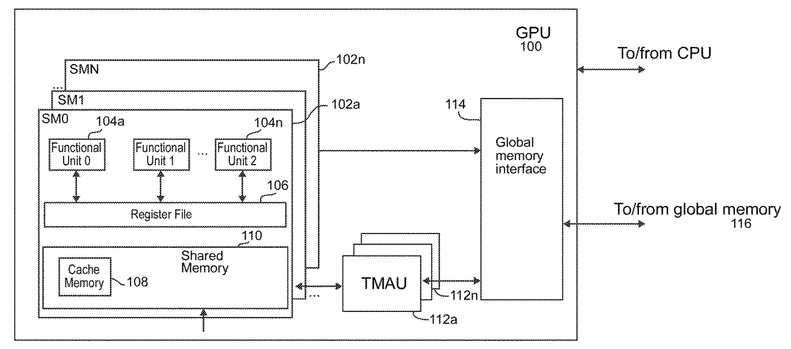 "NVIDIA TMA Patent Analysis" — 168 likes · 12 comments](https://zhuanlan.zhihu.com/p/1999510078827544585)

After a tile is submitted to `TMA`, the consumer cannot read it immediately. This is exactly where the transaction barrier matters: a traditional barrier mainly answers "have all threads arrived?"; Hopper's transaction-aware barrier additionally answers "have all promised data transactions arrived?" This matters greatly for the Tensor Core, because `WGMMA` consumes a whole matrix tile; if you only watch thread arrival without watching copy-transaction completion, you conflate "transport initiated" with "data is ready to be consumed."

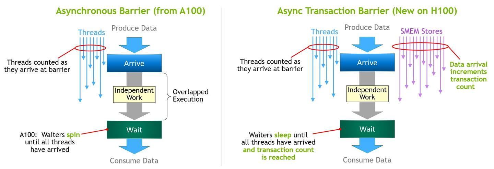

On the right, Hopper's key change is that the barrier state contains both thread arrival and transaction arrival; this corresponds exactly to the "completion and release" interface this document describes.

Reference for the specific design of mbarrier:

[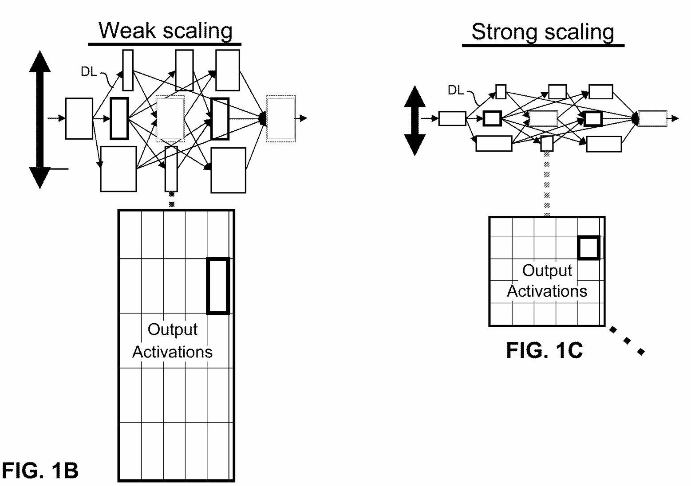 "NVIDIA Mbarrier Patent Analysis" — 96 likes · 4 comments](https://zhuanlan.zhihu.com/p/1996698248342152937)

Connecting these pieces, the main thread of Hopper can be written as the following producer-consumer chain:

```text
global / L2 tensor tile
  -> TMA descriptor-driven bulk copy
  -> local SMEM or DSM resident tile
  -> transaction-aware barrier confirms data arrival
  -> scheduler releases the waiting consumer group
  -> warp-group / WGMMA consumes the prepared matrix
```

This chain matters more than "Hopper added `WGMMA`." [PTX writes wgmma.mma_async as a warpgroup-level MMA](https://docs.nvidia.com/cuda/parallel-thread-execution/index.html#asynchronous-warpgroup-level-matrix-multiply-accumulate-instructions), and requires that all threads inside a warpgroup execute the same `.aligned` instruction; therefore it requires a readiness condition that goes beyond a single thread or single warp: the relevant tile is readable in `SMEM/DSM`, the relevant transaction is complete, the barrier is released, and the consuming warpgroup is at a consistent execution point. This condition can be compressed into one line:

```text
WGMMA-ready = resident tile + transaction completion + visibility + group release
```

These pieces must be read together. Looking at any single one will misread Hopper as "this module got stronger"; only when they are read together does the redefinition of the execution-domain boundary become visible:

-   `DSM` provides the cluster-scale shared medium
-   `TMA` is responsible for delivering large data into that medium
-   The transaction barrier turns "the data has truly arrived" into a hardware-waitable condition
-   `WGMMA` can then stably consume this data at the warp-group scale

There are still some uncertainties in this reading.

First, `FP8 / Transformer Engine` is Hopper's numerical control plane, but the current repository does not yet have direct enough patent evidence to nail down where scale is stored, the rounding boundary, or the internal interface between TE and the `WGMMA` datapath.

Second, the last hop `SMEM/DSM -> WGMMA` can still only be written as an interface-level judgment: public material can describe the contract among tile residency, barrier completion, and warpgroup consumption, but cannot infer the complete operand collector or internal pipeline structure from there.

So Hopper's historical position is not "another generation of Tensor Core enhancements" but **pushing the GPU from an execution machine where a single `SM` is the primary boundary for shared-memory-style cooperation and shared state, into a Thread Block Cluster / DSM-class cluster-scale cooperative execution machine**. The official material on thread block clusters, `DSM`, `TMA`, transaction barriers, and PTX `wgmma.mma_async` jointly support this point.

### 2.5 Blackwell: the problem keeps being pushed outward to package and chiplet boundaries

Hopper is not the end. It only pushed the problem from "how to organize things inside a single `SM`" to "how a cluster cooperates." Blackwell takes the problem further outward:

-   Precision keeps descending to `FP4 / MX`
-   `Tensor Memory (TMEM)` is promoted to an explicit on-SM object, formally elevating tile / intermediate-result storage near the Tensor Core into the foreground
-   The Tensor Core continues to be tied to coarser-grained data transport and execution choreography
-   The interconnect and packaging continue from cross-`GPU` links into tighter die-to-die / package-level structures

  

The official material already describes Blackwell as `two reticle-limited dies`, `10 TB/s chip-to-chip interconnect`, and `unified single GPU`. This shows that it is not simply scaling Hopper up: under the precondition that software still sees a single CUDA GPU, the physical implementation has been split into two reticle-limited dies that are recomposed into a unified GPU object via in-package interconnect.

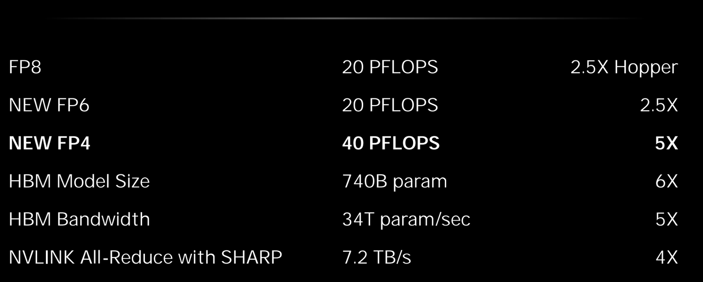

The above shows a comparison of acceleration effect, measured at the entire compute platform level, not at a single SM, single Tensor Core instruction, or a fixed multiplier of some datapath: peak `FP8 / FP6` is given as `20 PFLOPS`, about `2.5X` of Hopper; new `FP4` is given as `40 PFLOPS`, about `5X`; `HBM Model Size`, `HBM Bandwidth`, and `NVLINK All-Reduce with SHARP` each show `6X`, `5X`, and `4X` of system-side improvement. This means Blackwell's gains come from low-bit Tensor Core, HBM capacity/bandwidth, NVLink collective, and software stack working together — not just one matrix pipeline being faster.

These three lines should be read separately.

The first is **single-die -> unified multi-die single GPU**. Blackwell official material does not say that CUDA programmers should treat it as two GPUs; on the contrary, the [Blackwell Tuning Guide](https://docs.nvidia.com/cuda/archive/12.8.0/blackwell-tuning-guide/index.html) still emphasizes that it carries forward and extends the existing CUDA programming model. The change here happens between two things that used to be implicitly tied together: software still sees the `GPU` as a unified object, while the physical implementation can now be composed of two GPU dies and an in-package high-speed interconnect.

```text
software view:
  one CUDA GPU

physical implementation:
  die 0  <->  package chip-to-chip fabric  <->  die 1
```

The second is **FP4 / MX / Transformer Engine Gen2**. If we summarized it as just `FP8 -> FP4`, readers would mistake Blackwell for "halving the payload bit width again." In reality, the more important point is that scale, metadata, block size, packing, and format choice also enter the matrix-task description space. NVIDIA's official page discusses 2nd-gen `Transformer Engine` and `micro-tensor scaling` together; the subsequent [NVFP4 technical blog](https://developer.nvidia.com/blog/nvfp4-trains-with-precision-of-16-bit-and-speed-and-efficiency-of-4-bit/) describes NVFP4 as a recipe jointly composed of micro-block scaling, an E4M3 scale factor, Hadamard reshape, 2D block quantization, and stochastic rounding. So Blackwell's low-bit story is a combined contract:

```text
payload bits
  + scale factor
  + block granularity
  + metadata / packing
  + Transformer Engine format policy
```

  

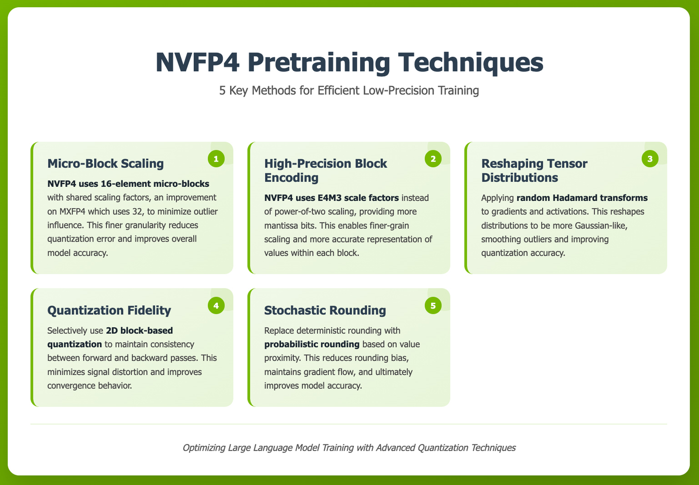

Image source: [NVFP4 Trains with Precision of 16-Bit and Speed and Efficiency of 4-Bit](https://developer.nvidia.com/blog/nvfp4-trains-with-precision-of-16-bit-and-speed-and-efficiency-of-4-bit/).

The third is **implicit operand residency -> explicit Tensor Memory object**. Per the CUDA Binary Utilities Blackwell instruction set, `tmem[URX]` is listed as a valid location, `LDT/LDTM` load a matrix from `Tensor Memory` into the register file, `STT/STTM` store a matrix from the register file back to `Tensor Memory`, while `UTCCP/UTCSHIFT` make the transport and reshuffle between shared memory and `Tensor Memory` independent objects. So Blackwell cares not only about "how to ship a tile to `SMEM/DSM`" but also about which operands, accumulators, scale, and metadata should sit in a layer of dedicated storage even closer to the Tensor Core.

This also explains why Blackwell cannot be simply read as "removing the Tensor Core" or "reverting to a warp-level Tensor Core." What it removes / replaces is the Hopper-style explicit `WARPGROUP` / `*GMMA` / `WGMMA` SASS encoding and execution interface; the new main thread becomes the object set of `tcgen05.mma`, `OMMA/QMMA`, `TMEM`, and `UTC*`. The key change is that issue semantics and data residency are split: Hopper still binds tightly to warp-group collective issue, where multiple warps must jointly execute `wgmma.mma_async` and manage completion via group commit / wait; Blackwell's `tcgen05.mma` recasts MMA initiation as single-thread semantics — one thread can start a whole matrix operation, but operands, scale, metadata, and result update are carried by tasks and layouts on Tensor Memory. "Single-thread semantics" here describes "who initiates the computation," not that one thread literally completes the entire matrix multiply-accumulate; it also breaks the surface constraint that "the entire warpgroup must execute the same MMA instruction in lockstep." So a more accurate reading is:

```text
Hopper:
  warpgroup collective issue
    -> WGMMA consumes SMEM / DSM resident tile
    -> result path returns through the group-level MMA protocol

Blackwell:
  one issuer
    -> TMEM-resident MMA task
    -> tcgen05.mma / OMMA-QMMA consume task descriptors
    -> TMEM-resident accumulator / D update
```

The "semantic center" of the matrix instruction has migrated from a register fragment held by the warpgroup to the matrix state in TMEM + descriptor + the CTA / CTA-pair instruction protocol of tcgen05.

In Hopper `wgmma`, the `d` accumulator and the optional `a` fragment are register operands distributed across participating threads; the instruction semantics are naturally organized around warpgroup collective issue. PTX also explicitly says that `d` is the accumulator/destination distributed across participating threads, and that `wgmma.wait_group` must be used to synchronize before access. By Blackwell `tcgen05`, PTX defines the 5th-gen Tensor Core's dedicated Tensor Memory as a per-CTA 2D on-chip storage: `D` lives in TMEM, `A` can live in TMEM or shared, and `B` lives in shared. `tcgen05.mma` uses operands such as `[d-tmem]`, `[a-tmem]` or `a-desc`, `b-desc`, `idesc`, `[scale-A-tmem]`, and `[scale-B-tmem]` — addresses or descriptors — to express the operation. More importantly, `tcgen05.mma` uses single-thread issue semantics, not the collective issue semantics of `mma.sync` / `wgmma.mma_async`.

Last is the system interconnect. Blackwell does not just compose two dies into one GPU within the package; it also continues to push external interconnect into a larger GPU domain. NVIDIA's official page discusses 5th-gen `NVLink`, `NVLink Switch`, and `NVL72` together; the architectural meaning is that the in-package die-to-die unified view inside one GPU and the multi-GPU NVLink / NVSwitch domain begin to jointly serve one problem: how to keep larger models, more GPUs, and finer low-bit matrix tasks at sufficiently high interconnect efficiency.

What it supports is system-level outward extrapolation: Blackwell's problem is no longer just inside the `SM`, but extends from Tensor Core near-end storage and in-package interconnect all the way out to rack-scale NVLink domains.

So what Blackwell signals is not that the story is over, but that **the subsequent problems are no longer confined to the `SM`, but increasingly involve overall organization among package, fabric, format, and cooperation domains**. If Fermi's key was pushing `global`-access semantics onto the memory side, Volta's key was pulling the matrix datapath and execution semantics out of the general-purpose machine, and Hopper's key was pushing the cooperative execution domain to the cluster, then Blackwell is more about pushing two more boundaries that had not been fully made explicit before: one is Tensor Core near-end storage moving from an implicit implementation layer into an explicit ISA / toolchain object; the other is that a single die's physical implementation no longer naturally equals the single GPU that software sees.

### 2.6 Other companies are also writing tensor-near storage as an explicit object

Strictly speaking, the naming `TMEM` in Blackwell is still very NVIDIA-specific; but if we widen the angle to "fix tensor tiles / intermediate results / high-reuse operands in a dedicated storage layer near the operator," other companies have actually written similar problems into patents — only with different naming, common variants being `tensor register file`, `tile registers`, `activation/weight/output buffer`, and memory-side tensor-aware buffers.

-   `US10372456B2` (Microsoft, earliest priority 2017) treats `tensor memory manager`, an input queue, and a `tensor register file` divided by operator type as explicit objects; the key point is that different tensor calculators can have their own dedicated tensor register files alongside them, and tensors are routed by operation type into near-end register storage instead of all repeatedly forwarded through one unified large store.
-   `EP4020173B1` (Intel, earliest priority 2020) treats the `data buffers` / `tile registers` of the matrix-operations accelerator and the `load-to-tile` / `store-from-tile` direct paths between them and the vector registers as ISA-level objects; this is close in spirit to Blackwell making `LDT/LDTM` and `STT/STTM` explicit, only it corresponds to a CPU-side matrix engine.
-   `US11922306B2` (Meta, earliest priority 2020) — whose central novelty is a tensor-controller architecture built around a counter stack — additionally chains `multi-bank activation memory`, a `weight buffer` (which can be implemented as a register file), `output buffer`, and a tensor controller into a local data-orchestration pipeline; the focus is not a single `MAC`, but how activations, weights, and partial sums are scheduled and reused inside the local hierarchy of a tensor processor.
-   `US10956315B2` / `US12229044B2` (Micron, same family, earliest priority 2018) cuts in from the memory side: the memory controller reserves a `data buffer` for tensor-friendly address patterns, so that frequently reused matrix data can be re-read directly from the buffer instead of going back to the memory array each time; this shows that "tensor-aware memory" can also grow first from the memory subsystem side.
-   `US11609785B2` (AMD, earliest priority 2019) is not literally called `TMEM`, but it broadcasts a shared matrix block in `GEMM` to the `local data stores` of multiple compute units after a single access; the focus is similarly on letting the same matrix / tensor data be reused multiple times near the operator, instead of repeatedly going through a far-end memory path.

Reading these patents alongside Blackwell makes it easier to see: industry consensus is not on one name, but on the same direction. As soon as matrix / tensor operators become the main path, the traditional `RF + SMEM/L1 + L2` is often insufficient to simultaneously carry throughput, reuse, and orchestration; so each company elevates `tensor-local storage` into a more explicit object, just under different names — `tensor register file`, `tile buffer`, or `activation/weight/output buffer`, or even a `tensor-aware memory controller` from the memory subsystem.

* * *

## 3. Evolution Across Different Technical Dimensions

### 3.1 Execution model: from `warp lockstep` to cluster-scale cooperative launch

**Core problem:** early GPUs treat a `warp` as a natural synchronous-advance unit, which simplifies control logic but also compresses divergence, long waits, and async events into "the whole warp pauses together first."

**Key change:** Volta is the first to systematically rewrite this default assumption. Rather than treating `ITS` as a scheduling optimization, it is more accurate to read it as detaching thread-progress semantics from the warp as the default synchronous-advance unit.

**Maturation:** Ampere's public main thread is more clearly expressed via `cp.async`, format expansion, and structured sparsity; the patent-side `shard scheduling` hints that scheduling granularity continues to descend, but should be cited as side-evidence rather than an official feature list. Hopper's `CGA` and cluster launch then push cooperation granularity upward. So the execution model is no longer just about how a warp advances, but about which smaller objects can wait independently and which larger objects can be launched cooperatively.

  

### 3.2 Data-supply chain: from `RF/collector` to `cp.async / TMA`-driven staging

**Original problem:** as long as the execution core is still a general `ALU/FPU`, the near-end data-supply chain mainly answers how to deliver register values to the execution port in time. Once a dedicated matrix path emerges, this chain immediately comes under pressure.

**Key change:** Kepler uses the collector cache to make `RF -> collector` local reuse explicit; Volta uses `US10338919B2` to nail down the `HMMA datapath` entry directly, showing that data supply is no longer only feeding general-purpose `ALU`s.

**Maturation:** Ampere's `cp.async` peels staging out of the traditional LSU path into an explicit protocol; Hopper's `TMA` then offloads bulk tile transport to a dedicated unit; Blackwell further promotes `Tensor Memory (TMEM)` into an explicit object: `tmem[URX]`, `LDT/LDTM`, `STT/STTM`, and `UTCCP` indicate that the data-supply problem has continued from staging protocol to dedicated near-Tensor-Core storage and movement objects. From here on, the question of how to deliver data to the operator entry is no longer only a register-level problem, but a protocol-level plus dedicated-storage-level problem.

  

### 3.3 Precision: from a general-purpose floating-point path to a format system organized by compute semantics

**Original problem:** when computation was still mainly organized around the general floating-point path, format change looked more like "the same pipeline supports more modes." That is not yet how today's Tensor Core precision line is written.

**Key change:** Pascal's dual `FP16` is a precursor, but the real turning point is at Volta: once `HMMA` becomes its own datapath, formats start to follow the dedicated path, instead of being only a parameter table for the general `FPU`. As a result, `FP16 input + FP32 accumulate` becomes the first stable type set.

**Maturation:** Turing makes `INT8/INT4` an explicit branch; Ampere advances `BF16/TF32` and structured sparsity in parallel; Hopper brings `FP8` and the Transformer Engine in; Blackwell pushes the question further into `FP4 / MX`. The real theme of this line is not "more and more formats," but **formats start to serve different compute semantics and different throughput paths.**

  

### 3.4 Synchronization primitives: from register dependency to transaction and domain

**Core problem:** Tesla / early-GPU synchronization is more about pending writes, scoreboards, and local progress conditions; what it solves is "can this instruction issue," not "is this batch of async work actually consumable."

**Key change:** Maxwell's software scoreboard and convergence barrier first push synchronization objects from implicit hardware dependency to programmable barriers; after Volta, with `ITS`, asynchronous transport, and more complex reconvergence entering the main path, synchronization primitives are no longer just an appendage of the scheduler.

**Maturation:** Ampere's execution barrier metadata stabilizes `Join/Wait/Cancel`; Hopper's transaction barrier and memory sync domain separate "wait on threads," "wait on transactions," and "wait on the visibility of some domain" into different layers.

  

### 3.5 Interconnect: from on-chip `crossbar` to cross-`GPU` and cross-package cooperation

**Core problem:** early interconnect feels like a problem of how to deliver `SM`-side requests to partition / memory interfaces, so it is easily seen as a background routing problem rather than an architectural-semantics problem.

**Key change:** after Pascal, the interconnect no longer just answers whether bandwidth is sufficient; it begins to answer how far the cooperation boundary should extend, and how coherence and visibility are guaranteed. With `NVLink`, `NVSwitch`, `C2C`, and `NV-HBI`, the interconnect is no longer just a transport layer; it becomes part of the cooperation model.

**Maturation:** the interconnect problem has moved from on-chip routing to cross-`GPU`, cross-CPU-GPU domains, and into in-package cooperation.

  

## 4. ISA-Level Evolution: How SASS Changes Surface the Hardware Evolution Above

The five main threads above are mainly about how hardware boundaries change; at the ISA level, the question becomes: **which new hardware objects have become important enough to be written as explicit SASS instructions, and which old protocols are replaced by new encodings and execution models?** Here, SASS is not treated as an isolated opcode list, because an opcode by itself only proves the encoding exists; what is really explanatory is the hardware state, wait object, data-supply path, or cooperation boundary that opcodes expose when they appear or disappear in groups.

So the ISA layer is not another physical main thread fully parallel to the previous five; it is more like the projection of those threads at the machine-instruction layer. An execution protocol that is only an internal microarchitectural detail typically does not appear stably in SASS readings; once it becomes `BSSY/BSYNC`, `DEPBAR`, `LDGSTS`, `UTMA*`, `UCGABAR_*`, `LDT/LDTM`-class instructions or addressing modes, it means the compiler, assembler, scheduler, and analysis tools all must handle it head-on. This is also why SASS evolution is suitable as side-evidence for architectural evolution: it does not replace patents and official architecture material, but it helps judge whether a mechanism has moved from "may exist internally in the implementation" into "the toolchain and machine code must acknowledge it."

From this angle, several of the most explanatory groups of instruction changes come first:

-   When the execution model is rewritten, old reconvergence conventions like `SSY/SYNC` retire, and new objects like `BSSY/BSYNC/WARPSYNC/DEPBAR` appear.
-   When the matrix path is split out of the general `FPU`, `HMMA/IMMA/BMMA/DMMA/GMMA` first write the matrix path as SASS objects; by Blackwell, parts of Hopper's `*GMMA` / `WARPGROUP` forms are removed, and `OMMA/QMMA` and `TMEM`-related instructions become the new observation point.
-   When the warp-uniform datapath is officially built, `R2UR/S2UR/UIADD3/U*`-class uniform-path instructions appear in batches.
-   When async staging, cluster cooperation, and `TMA` enter the main path, instructions like `LDGSTS/LDGDEPBAR/UTMA*/WARPGROUP/UCGABAR*/UTCBAR` directly expose new wait objects, transport objects, and cooperation objects.

From this angle, SASS instruction history is not a sparse "list of newly added instructions," but another generation-level evidence trail much closer to hardware-boundary changes. The full opcode list does not belong in the overview README; it belongs in a SASS-specific document, while the README only keeps the explanation of how this thread interprets architectural breakpoints.

Putting the instruction history back onto the Tesla -> Blackwell main thread yields a clean reading:

-   **Maxwell / Pascal** are still dominated by traditional `SIMT`, classic load/store, texture/surface, old-style reconvergence, and integer/floating-point mixed arithmetic, indicating that the ISA body still serves the "general-purpose, lockstep, single-`SM`-as-primary-boundary" machine of that period.
-   **Volta** is the first true major rewrite. The new `BSSY/BSYNC/WARPSYNC/DEPBAR` rewrite execution sync objects, `HMMA/IMMA` make the matrix path an instruction, and forms like `FADD32I/FFMA32I/IADD32I/MOV32I` show that immediates and the new datapath organization are also re-encoded. At the same time, old objects like `SSY/SYNC/XMAD` retire, indicating that the old execution protocol and old integer-multiply-add habits are no longer central.
-   **Turing**'s newly added instructions best illustrate that the uniform datapath is officially landing: a whole string of `U*` instructions like `R2UR/S2UR/UIADD3/UIMAD/UISETP/ULDC/ULEA/USEL/USHF/VOTEU` shows that warp-uniform values now have explicit data paths and operation sets; `LDSM` and `BMMA` continue to push matrix data supply and low-bit matrix computation forward.
-   **Ampere / Ada** do not rewrite the basic direction the way Volta did; they bring the new machine to maturity and stability. `LDGSTS` and `LDGDEPBAR` push the async staging and wait protocols into the instruction layer; `DMMA` continues to expand the matrix path; `F2IP/I2FP/UF2FP` and the like make format conversion and path conversion routine operations.
-   **Hopper** is the first time cluster cooperation, `TMA`, warp groups, and bulk async transport grow into a complete set of ISA objects. Names like `UTMA*`, `UCGABAR_*`, `WARPGROUP`, `UBLK*`, `ENDCOLLECTIVE`, `SYNCS`, `CGAERRBAR`, and `PREEXIT` themselves indicate that wait objects, transport objects, and cooperation objects are no longer confined to a single warp or single `SM`.
-   **Blackwell** then continues to push the problem onto bigger matrix operators, finer uniform floating-point paths, stronger work-distribution / transport protocols, and explicit `Tensor Memory` objects. `OMMA/QMMA`, `LDT/LDTM/STT/STTM`, `UTC*`, `UGETNEXTWORKID`, `UVIRTCOUNT`, and many `UF*` / `UI*` variants show that package / fabric / tensor / uniform directions are continuing to expand at the ISA layer; at the same time, public SASS history no longer lists Hopper's `WARPGROUP/WARPGROUPSET` and parts of the `*GMMA` forms, so this should not be written as "WGMMA SASS forms keep getting strengthened" but as "the encoding and execution protocol keep converging — matrix tasks descend from the surface of warpgroup instructions into the new interface set of `TMEM + descriptor + tcgen05`."

## 5. Summary: Three Architectural Rewrites

If we condense the three most important architectural rewrites of the past two decades, they amount to the following:

| Patent | Generation | Representative meaning |
| --- | --- | --- |
| US9639479B2 | Fermi | L2/partition turns from passive cache background into a software-observable, software-tunable memory-side domain |
| US10338919B2 | Volta | HMMA datapath is peeled out of the general floating-point path |
| US20230289189A1 | Hopper | The effective scope of shared memory is extended to a cluster-scale DSM |

Ten-generation overview (legend: ✅ well-supported by patent + official material; ⚠️ partially supported / inferential; ❌ thin or missing evidence)

| Generation | Execution | Data supply | Precision | Sync | Interconnect | Notes |
| --- | --- | --- | --- | --- | --- | --- |
| Tesla | ⚠️  | ✅   | ❌   | ⚠️  | ✅   | Baseline machine is reasonably clear; the early SIMT / scratchpad root patents are still thin |
| Fermi | ⚠️  | ❌   | ❌   | ❌   | ✅   | Memory side is strong; front-end execution and unified address space still need filling in |
| Kepler | ⚠️  | ✅   | ❌   | ❌   | ⚠️  | Data-supply loop is strong; interconnect and Dynamic Parallelism remain skeletal |
| Maxwell | ✅   | ⚠️  | ❌   | ✅   | ⚠️  | Barrier-ization and reconvergence are strong |
| Pascal | ⚠️  | ✅   | ✅   | ❌   | ⚠️  | FP16 line is fairly stable; NVLink 1.0 still has room to deepen |
| Volta | ✅   | ✅   | ✅   | ✅   | ⚠️  | One of the most complete generations in this corpus |
| Turing | ✅   | ✅   | ⚠️  | ⚠️  | ⚠️  | INT8/INT4 and interconnect still have room for additional evidence |
| Ampere | ✅   | ✅   | ⚠️  | ✅   | ⚠️  | cp.async is strong; precision and MIG remain unbalanced |
| Hopper | ✅   | ✅   | ⚠️  | ✅   | ✅   | SM, sync, and cluster cooperation are currently the strongest areas |
| Blackwell | ⚠️  | ✅   | ⚠️  | ⚠️  | ⚠️  | FP4/TMEM/dual-die single-GPU entry is in place, but sync and patent details are still under construction |

Stitching these three together yields a clear main thread:

-   First, **processing ownership and control semantics** expand outward from inside the `SM` toward the memory side
-   Then, **execution and data-supply paths** split from a general-purpose machine toward a specialized machine
-   Finally, **the cooperation boundary** keeps pushing outward from a single `SM` to the cluster, the interconnect, and the package

Once these three steps are understood, the ten-generation timeline from Tesla to Blackwell stops being loose and starts looking like the same machine being repeatedly rewritten by the pressures of the next generation.
